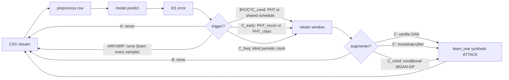

# DriftGAN — GAN-assisted concept-drift adaptation for streaming intrusion detection

**Abstract.** Streaming intrusion detectors degrade when attack traffic drifts away from the distribution they were trained on. This project turns a proof-of-concept (Hoeffding Adaptive Tree + Page-Hinkley drift detection + GAN-based sample augmentation on CICIDS2017) into a reproducible, statistically defensible experiment: a shared drift schedule makes phases comparable event-by-event, per-event recovery metrics (RT, AUD) quantify adaptation quality, a naive-oversampling control isolates the GAN's contribution, and an experimental generative monitor tests whether reconstruction error can *anticipate* drift rather than react to it. The full 5-seed experiment has been run and hardened with reviewer-oriented controls — a frequency-matched adaptation control, an ablation of the generative monitor against cheap covariate-shift statistics, and state-of-the-art streaming baselines (ADWIN/KSWIN detectors, ARF/SRP ensembles). Two findings are firm: **GAN-based *adaptation* gives no measurable benefit over the reactive baseline** (a null result, honestly reported), while the **generative *early-detection* monitor does anticipate drift** and, driven proactively, sustains detection quality — with the caveat that a cheap linear monitor nearly matches the autoencoder. See [Results](#8-results).

## 1. Motivation

Network intrusion detection systems trained offline face non-stationary traffic: new attack campaigns, tool variants and scanning behaviors shift the input distribution (covariate drift) and the input→label relation (real drift). A frozen model silently decays; error-based detectors (like the Page-Hinkley test) only react *after* misclassifications accumulate — precisely the window in which attacks go undetected. The interesting question is not whether adaptation helps (it does) but **how fast a detector recovers, at what computational cost, and whether generative models can shorten — or even anticipate — the recovery window** when only a handful of samples of the new attack exist.

## 2. Contributions

1. **Shared drift schedule** — all compared phases adapt at identical stream indices, making per-event pairing (and paired statistics) valid. (`src/driftgan/drift/schedule.py`)
2. **Per-event recovery protocol** — Recovery Time, Area Under Deficit, min-F1 and no-recovery flags with explicit handling of F1-undefined windows and overlapping events. (`src/driftgan/metrics/recovery.py`)
3. **Augmentation control** — bootstrap+jitter baseline with the same synthetic-sample budget as the GAN, separating "more samples" from "better samples". (`src/driftgan/augment/bootstrap_jitter.py`)
4. **Subtype-conditional WGAN-GP** — drift-time generation conditioned on the attack subtype actually present in the buffer. (`src/driftgan/augment/cgan.py`)
5. **Generative early-detection monitor (experimental)** — an incrementally trained autoencoder whose reconstruction error feeds a second PHT; lead time over error-based detection is measured, including anticipated false positives. (`src/driftgan/early/reconstruction_monitor.py`)
6. **Frequency-matched adaptation control** — a phase that adapts on a blind periodic clock at the same count as the early monitor, separating adaptation *frequency* from adaptation *timing*. (`C_freq`, `drift/schedule.py:PeriodicTrigger`)
7. **Monitor ablation** — cheap covariate-shift monitors (linear PCA reconstruction, per-feature KS, RBF-MMD, mean-shift) sharing the autoencoder's exact protocol, to test whether the generative model is justified as the anticipation signal. (`src/driftgan/early/shift_monitors.py`)
8. **State-of-the-art baselines** — alternative drift detectors on the HAT (ADWIN, KSWIN) and self-adapting streaming ensembles (Adaptive Random Forest, Streaming Random Patches), plus **budget-matched variants** that restrict the ensembles to the same triggered adaptation budget as the reactive baseline. (`src/driftgan/models/streaming.py`, `drift/schedule.py:DynamicDetectorTrigger`)
9. **Reproducibility & cost accounting** — multi-seed CLI, manifests (git/config/data hashes), bootstrap CIs, paired Wilcoxon + effect sizes, per-component latency breakdown and RSS tracking; publication figures under `results/report/paper/`.

## 3. Related work

- Hoeffding Adaptive Trees and prequential evaluation for evolving data streams `[TODO: cite Bifet & Gavaldà 2009]`
- Page-Hinkley test for change detection in streams `[TODO: cite Page 1954; Gama et al. 2013 survey]`
- Concept-drift adaptation surveys `[TODO: cite Gama et al. 2014; Lu et al. 2019]`
- Generative replay / pseudo-rehearsal for continual learning `[TODO: cite Shin et al. 2017]`
- GAN-based augmentation for network intrusion detection `[TODO: cite e.g. Usama et al. 2019; Ring et al. 2019 flow-based generation]`
- WGAN-GP and spectral normalization `[TODO: cite Gulrajani et al. 2017; Miyato et al. 2018]`
- CICIDS2017 dataset `[TODO: cite Sharafaldin et al. 2018]`

## 4. Methodology

One prequential engine (`src/driftgan/experiments/runner.py`) runs every phase; phases differ only in **model**, **trigger** and **augmenter**:



**Core phases** — the proposals and their controls:

| Phase | Model | Trigger | Augmentation | Role |
|---|---|---|---|---|
| A | HAT | none (frozen) | — | lower-bound control |
| B | HAT | PHT / schedule | — | reactive baseline |
| C | HAT | PHT / schedule | vanilla binary GAN | original proposal |
| C' | HAT | PHT / schedule | bootstrap + jitter | augmentation control |
| C_cond | HAT | PHT / schedule | subtype-conditional WGAN-GP | improved proposal |
| C_early | HAT | dual PHT (recon + class) | optional | anticipation experiment |

**Reviewer controls & baselines** — added to harden the analysis:

| Phase | Model | Trigger | Isolates |
|---|---|---|---|
| C_freq | HAT | blind periodic clock (matched count) | adaptation *timing* vs *frequency* |
| C_early_mean / C_early_pca | HAT | dual PHT, monitor = mean-shift / PCA | whether the AE monitor is justified |
| B_adwin / B_kswin | HAT | ADWIN / KSWIN | drift-detector choice |
| ARF / SRP | ensemble | none (continuous learning) | SOTA upper bound (full supervision) |
| ARF_sched / SRP_sched | ensemble | PHT / schedule | model capacity at a matched label budget |

Details: [docs/methodology.md](docs/methodology.md) and [docs/gan_design.md](docs/gan_design.md).

## 5. Dataset

CICIDS2017 (CSV export, ~2.8M flow records, ~70 numeric flow features, label column `Attack Type` with BENIGN plus attack subtypes: DoS variants, PortScan, brute force (FTP/SSH), web attacks, Bot, Infiltration, DDoS). Preprocessing per row: drop identifier columns (`Flow ID`, IPs, `Timestamp`), coerce features to float, replace ±inf/NaN with 0, binarize label to BENIGN/ATTACK keeping the raw subtype for conditioning and ground-truth schedules. The stream is read in file order starting at row 540,000 (skipping the long initial all-benign block) so that pre-training (~50K samples) is essentially benign and attack bursts arrive afterwards. The dataset is **not** included in this repository; set `csv_path` in `configs/base.yaml`.

## 6. Experimental protocol

- **Shared schedule**: pass 0 (Phase B dynamics) records PHT fire indices → all scheduled phases replay them; a report-only PHT measures detection delay. A label-derived ground-truth schedule is available for sensitivity analysis. C_early is exempt (its claim is anticipation).
- **Seeds**: ≥5 per phase (`--seeds 0,1,2,3,4`), seeding python/numpy/torch/HAT/augmenters.
- **Metrics**: rolling F1 (window 5,000) snapshots every 500 samples; per-event RT (θ=0.9, k=3 sustained), AUD, min-F1, no-recovery (H=50,000); lead time and anticipated-FP/missed-anticipation rates for C_early; latency p50/p95/p99/max with per-component breakdown; peak RSS.
- **Statistics**: percentile-bootstrap 95% CIs; Wilcoxon signed-rank paired by drift index; Cliff's delta and r effect sizes.
- **Reviewer experiments** (beyond the six core phases): a frequency-matched adaptation control (`C_freq`); a monitor ablation replacing the autoencoder with cheap covariate-shift statistics, first offline (signal-detectability frontier) then in the full pipeline (`C_early_mean`, `C_early_pca`); SOTA baselines (`ARF`/`SRP` continuous, `B_adwin`/`B_kswin` detectors) and their budget-matched variants (`ARF_sched`/`SRP_sched`); and resource/latency profiling plus C_early operating-point sensitivity from the persisted recon-error series.

## 7. Reproducing the results

```bash
git clone <repo> && cd DriftGAN
# 1. install uv (https://docs.astral.sh/uv/) then:
make setup                 # creates .venv from uv.lock
make test                  # unit + end-to-end synthetic smoke tests
# 2. obtain CICIDS2017 CSV and point configs/base.yaml:csv_path at it
make smoke                 # 10K-sample sanity run against the real CSV
# 3. full experiment
make schedule              # pass 0: build the shared drift schedule
make run-all SEEDS=0,1,2,3,4
make report                # tables + figures under results/report/
# 4. reviewer experiments + baselines (optional, hours for ARF/SRP)
make run-C-freq            SEEDS=0,1,2,3,4   # frequency-matched control (#1)
make run-sota              SEEDS=0,1,2,3,4   # ADWIN/KSWIN + ARF/SRP (#3)
make run-sota-matched      SEEDS=0,1,2,3,4   # budget-matched ARF/SRP (#3b)
uv run python run_experiment.py --phase C_early_mean --seeds 0,1,2,3,4 --n-jobs 5  # monitor ablation (#2)
uv run python run_experiment.py --phase C_early_pca  --seeds 0,1,2,3,4 --n-jobs 5
# 5. publication figures (from the runs above)
uv run python scripts/paper_figures.py       # fig1-3, fig6, fig8-10 (verdict + ablations)
uv run python scripts/reviewer_analysis.py   # fig4 resources, fig5 sensitivity
uv run python scripts/monitor_ablation.py    # fig7 monitor detectability frontier
```

Each run writes `results/runs/<phase>/seed_<s>/` with `manifest.json` (git hash, config hash, CSV SHA-256, package versions), `snapshots.parquet`, `drift_events.json`, `cost.json`, `trace.csv.gz`, and per-event recovery parquet under `results/recovery/`.

## 8. Results

Full 5-seed run over the ~2M-sample stream (`make report` → `results/report/`; publication figures under `results/report/paper/`). Core phases:

| Phase | F1_final | mean_RT | mean_AUD | no_recovery | p95 latency (ms) | peak RSS (MB) |
|---|---|---|---|---|---|---|
| A (frozen) | 0.362 | — | — | — | 0.12 | 776 |
| B (reactive PHT) | 0.788 | 433 | 1246 | 0.66 | 0.39 | 780 |
| C (vanilla GAN) | 0.789 | 477 | 1370 | 0.66 | 0.46 | 1365 |
| C_cond (WGAN-GP) | 0.768 | 396 | 1588 | 0.69 | 0.29 | 1558 |
| C' (bootstrap+jitter) | 0.769 | 392 | 1667 | 0.69 | 0.28 | 779 |
| C_early (gen. monitor) | **0.986** | 1094* | 3701* | 0.71 | 0.47 | 1397 |

\* C_early's RT/AUD are confounded: it adapts proactively and is schedule-exempt, so per-event pairing is weak (few paired events). Its fair headline is final/sustained F1 and lead time, not RT/AUD.

**Two firm findings.**

1. **GAN-based *adaptation* is a null result.** Paired Wilcoxon on the shared schedule: C vs B is statistically indistinguishable (RT p=0.62, AUD p=0.62); C_cond and C' are *worse* on AUD with negligible effect sizes (|Cliff's δ| < 0.07). Feature-scale collapse (which had made the vanilla and conditional GANs byte-identical) was fixed first, so this is a genuine negative, not a bug. **Conclusion: sample *quantity/quality* from the GAN does not improve drift recovery over the reactive baseline.**
2. **The generative *early-detection* monitor (C_early) is the positive result.** Final F1 0.986 (tight across seeds), with genuinely positive anticipation lead times (~6–9K samples). Its advantage is concentrated in the drift-dense second half of the stream (local F1 +0.10–0.14 over B). Two controls confirm the mechanism: a **frequency-matched control** (C_freq, blind periodic clock at the same adaptation count) collapses *below* the reactive baseline — so the gain is *when* it adapts, not *how often*; and swapping the autoencoder for a **linear PCA monitor nearly matches it** (final 0.969 vs 0.986) while a trivial mean-shift monitor does not (0.778) — the generative model is over-engineered but a reconstruction signal is needed. Honest caveat: the anticipation *recall* at the operating point is modest (~0.23 — it foresees about a quarter of drifts).

**State-of-the-art context.** Self-adapting streaming ensembles (Adaptive Random Forest, Streaming Random Patches) reach ~1.00 final and 0.77–0.81 sustained F1, above C_early's 0.60 sustained — but they learn on *every* sample (~2M supervised updates). Budget-matched to the reactive baseline's ~233 triggered adaptations, they still score 0.72–0.73 (vs B/C_early ≈ 0.57–0.60): **the SOTA lead is driven mainly by model capacity, not by continuous supervision** (which adds only ~0.05–0.08). Alternative drift detectors (ADWIN, KSWIN) do *not* beat plain Page-Hinkley. The practical takeaway is that a stronger base learner under the same sparse drift-triggered adaptation captures most of the benefit — the natural place to carry the C_early monitor next.

Figures: `fig1` local-F1 trajectory, `fig2` recovery comparison, `fig3` lead-time & cost/benefit, `fig4` resource/latency profile, `fig5` operating-point sensitivity, `fig6` frequency-control ablation, `fig7` monitor detectability frontier, `fig8` SOTA baselines, `fig9` monitor swapped in-pipeline, `fig10` budget-matched SOTA.

## 9. Discussion

Interpretation and limitations:

- **The honest positioning is scope, not raw F1.** On raw quality no DriftGAN component wins outright: GAN adaptation is null, the generative monitor is nearly matched by cheap linear PCA, and stronger base learners beat C_early. C_early's defensible contribution is *within the HAT + sparse-triggered-adaptation family*, where proactive early detection genuinely helps and its cost is a single lightweight tree.
- **Base-learner bottleneck**: the budget-matched SOTA runs show that swapping the single HAT for an ensemble at the *same* ~233 adaptations already outperforms C_early on sustained F1. The most promising direction is to pair the early-monitor / proactive-adaptation idea with a stronger base learner rather than a stronger augmenter.
- **Label budget vs continuous supervision**: ensembles retain ~93% of their performance with sparse drift-triggered adaptation versus full continuous learning, so "adapt only at detected drift" is a reasonable, label-efficient regime — the comparison to continuous-learning SOTA is therefore reported with the adaptation-budget explicit, not as a like-for-like F1 race.
- **Schedule bias**: the shared schedule is derived from B's dynamics; it makes pairing valid but slightly favors strategies that behave like B. The label-derived schedule bounds this effect.
- **Oracle labels**: prequential evaluation assumes labels arrive immediately after prediction; in real IDS deployments labels are delayed or partial. All phases share this assumption, so comparisons remain internally valid.
- **GAN scale**: buffers of 5–500 samples are extreme for GAN training; the C' control exists precisely because "the GAN worked" is not credible without it — and indeed it did not.
- **Single dataset / ordering**: results are tied to CICIDS2017's specific attack ordering; a second-dataset replication (CIC-IDS2018 / UNSW-NB15) is in progress.

## 10. Repository structure

```
src/driftgan/
├── config.py          # YAML config resolution (base + phase overrides), run dirs, hashes
├── logging.py          # JSON-line structured logging
├── data/stream.py       # streaming CSV reader + row preprocessing
├── models/
│   ├── hat.py            # HAT factory (identical hyperparams across HAT phases)
│   └── streaming.py      # model factory: HAT vs ARF/SRP ensembles (+ continuous phases)
├── drift/schedule.py      # shared schedules; dynamic-PHT / detector / periodic / scheduled triggers
├── augment/               # base protocol + FeatureScaler, bootstrap_jitter, vanilla_gan, wgan_gp, cgan
├── early/
│   ├── reconstruction_monitor.py  # autoencoder monitor (AE)
│   ├── shift_monitors.py          # cheap ablations: PCA / KS / MMD / mean-shift
│   └── dual_pht.py                # dual PHT + lead-time pairing
├── metrics/               # rolling (O(1) F1), recovery (RT/AUD), cost, gan_quality
├── experiments/           # runner (unified engine), seeding, manifest, stats
└── viz/plots.py           # stream comparison, boxplots, RT CDF, Pareto
configs/                 # base.yaml + one YAML per phase (core + reviewer/SOTA/ablation phases)
scripts/                 # make_report.py; paper_figures.py, reviewer_analysis.py, monitor_ablation.py
notebooks/               # 03_recovery_analysis, 05_early_detection (analysis only)
tests/                   # pytest: recovery, schedule/triggers, early monitors, models, stats, augment, e2e
run_experiment.py        # multi-seed CLI (also builds the schedule: --build-schedule)
Makefile                 # setup / test / lint / smoke / schedule / run-* / run-sota[-matched] / report
```

## 11. Future work

- **Second dataset** (in progress): replicate on CIC-IDS2018 / UNSW-NB15 / CIC-DDoS2019, and randomize attack-block ordering to decouple results from CICIDS2017's specific sequence.
- Label-delay simulation (labels arriving k samples late) to stress the prequential assumption — currently all phases assume immediate labels.
- Pair a lightweight ensemble with the sparse triggered-adaptation regime (the budget-matched SOTA runs suggest model capacity, not continuous supervision, drives the ensemble lead).
- Adaptive `n_synthetic` per event (scale with buffer size / detector confidence).
- Diffusion or flow-based generators as drop-in augmenters; use the monitor's latent drift direction to *select* which buffer samples to train the GAN on.

(Done since the initial draft: per-feature standardization inside the GAN augmenters — `augment/base.py:FeatureScaler` — which fixed a feature-scale collapse that had made the vanilla and conditional GANs produce identical output.)

## 12. Citation

```bibtex
@misc{driftgan2026,
  title  = {DriftGAN: GAN-assisted concept-drift adaptation for streaming intrusion detection},
  author = {Lara Guti\'errez, Antonio},
  year   = {2026},
  note   = {https://github.com/antoniol00/DriftGAN}
}
```

## 13. License

No license file yet — all rights reserved until one is chosen. `[TODO: pick a license]`
