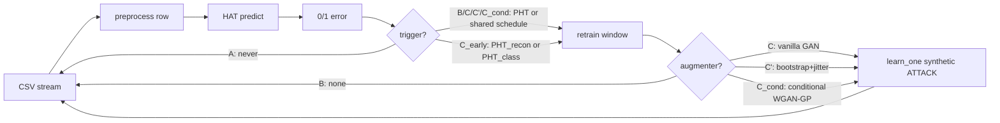

# DriftGAN — GAN-assisted concept-drift adaptation for streaming intrusion detection

**Abstract.** Streaming intrusion detectors degrade when attack traffic drifts away from the distribution they were trained on. This project turns a proof-of-concept (Hoeffding Adaptive Tree + Page-Hinkley drift detection + GAN-based sample augmentation on CICIDS2017) into a reproducible, statistically defensible experiment: a shared drift schedule makes phases comparable event-by-event, per-event recovery metrics (RT, AUD) quantify adaptation quality, a naive-oversampling control isolates the GAN's contribution, and an experimental generative monitor tests whether reconstruction error can *anticipate* drift rather than react to it. Full-scale results are pending (see [Results](#8-results)).

## 1. Motivation

Network intrusion detection systems trained offline face non-stationary traffic: new attack campaigns, tool variants and scanning behaviors shift the input distribution (covariate drift) and the input→label relation (real drift). A frozen model silently decays; error-based detectors (like the Page-Hinkley test) only react *after* misclassifications accumulate — precisely the window in which attacks go undetected. The interesting question is not whether adaptation helps (it does) but **how fast a detector recovers, at what computational cost, and whether generative models can shorten — or even anticipate — the recovery window** when only a handful of samples of the new attack exist.

## 2. Contributions

1. **Shared drift schedule** — all compared phases adapt at identical stream indices, making per-event pairing (and paired statistics) valid. (`src/driftgan/drift/schedule.py`)
2. **Per-event recovery protocol** — Recovery Time, Area Under Deficit, min-F1 and no-recovery flags with explicit handling of F1-undefined windows and overlapping events. (`src/driftgan/metrics/recovery.py`)
3. **Augmentation control** — bootstrap+jitter baseline with the same synthetic-sample budget as the GAN, separating "more samples" from "better samples". (`src/driftgan/augment/bootstrap_jitter.py`)
4. **Subtype-conditional WGAN-GP** — drift-time generation conditioned on the attack subtype actually present in the buffer. (`src/driftgan/augment/cgan.py`)
5. **Generative early-detection monitor (experimental)** — an incrementally trained autoencoder whose reconstruction error feeds a second PHT; lead time over error-based detection is measured, including anticipated false positives. (`src/driftgan/early/`)
6. **Reproducibility & cost accounting** — multi-seed CLI, manifests (git/config/data hashes), bootstrap CIs, paired Wilcoxon + effect sizes, per-component latency breakdown and RSS tracking.

## 3. Related work

- Hoeffding Adaptive Trees and prequential evaluation for evolving data streams `[TODO: cite Bifet & Gavaldà 2009]`
- Page-Hinkley test for change detection in streams `[TODO: cite Page 1954; Gama et al. 2013 survey]`
- Concept-drift adaptation surveys `[TODO: cite Gama et al. 2014; Lu et al. 2019]`
- Generative replay / pseudo-rehearsal for continual learning `[TODO: cite Shin et al. 2017]`
- GAN-based augmentation for network intrusion detection `[TODO: cite e.g. Usama et al. 2019; Ring et al. 2019 flow-based generation]`
- WGAN-GP and spectral normalization `[TODO: cite Gulrajani et al. 2017; Miyato et al. 2018]`
- CICIDS2017 dataset `[TODO: cite Sharafaldin et al. 2018]`

## 4. Methodology

Six phases share one prequential engine (`src/driftgan/experiments/runner.py`); they differ only in trigger and augmenter:



| Phase | Trigger | Augmentation | Role |
|---|---|---|---|
| A | none (frozen) | — | lower-bound control |
| B | PHT / schedule | — | reactive baseline |
| C | PHT / schedule | vanilla binary GAN | original proposal |
| C' | PHT / schedule | bootstrap + jitter | augmentation control |
| C_cond | PHT / schedule | subtype-conditional WGAN-GP | improved proposal |
| C_early | dual PHT (recon + class) | optional | anticipation experiment |

Details: [docs/methodology.md](docs/methodology.md) and [docs/gan_design.md](docs/gan_design.md).

## 5. Dataset

CICIDS2017 (CSV export, ~2.8M flow records, ~70 numeric flow features, label column `Attack Type` with BENIGN plus attack subtypes: DoS variants, PortScan, brute force (FTP/SSH), web attacks, Bot, Infiltration, DDoS). Preprocessing per row: drop identifier columns (`Flow ID`, IPs, `Timestamp`), coerce features to float, replace ±inf/NaN with 0, binarize label to BENIGN/ATTACK keeping the raw subtype for conditioning and ground-truth schedules. The stream is read in file order starting at row 540,000 (skipping the long initial all-benign block) so that pre-training (~50K samples) is essentially benign and attack bursts arrive afterwards. The dataset is **not** included in this repository; set `csv_path` in `configs/base.yaml`.

## 6. Experimental protocol

- **Shared schedule**: pass 0 (Phase B dynamics) records PHT fire indices → all scheduled phases replay them; a report-only PHT measures detection delay. A label-derived ground-truth schedule is available for sensitivity analysis. C_early is exempt (its claim is anticipation).
- **Seeds**: ≥5 per phase (`--seeds 0,1,2,3,4`), seeding python/numpy/torch/HAT/augmenters.
- **Metrics**: rolling F1 (window 5,000) snapshots every 500 samples; per-event RT (θ=0.9, k=3 sustained), AUD, min-F1, no-recovery (H=50,000); lead time and anticipated-FP/missed-anticipation rates for C_early; latency p50/p95/p99/max with per-component breakdown; peak RSS.
- **Statistics**: percentile-bootstrap 95% CIs; Wilcoxon signed-rank paired by drift index; Cliff's delta and r effect sizes.

## 7. Reproducing the results

```bash
git clone <repo> && cd DriftGAN
# 1. install uv (https://docs.astral.sh/uv/) then:
make setup                 # creates .venv from uv.lock
make test                  # unit + end-to-end synthetic smoke tests
# 2. obtain CICIDS2017 CSV and point configs/base.yaml:csv_path at it
make smoke                 # 10K-sample sanity run against the real CSV
# 3. full experiment
make schedule              # pass 0: build the shared drift schedule
make run-all SEEDS=0,1,2,3,4
make report                # tables + figures under results/report/
```

Each run writes `results/runs/<phase>/seed_<s>/` with `manifest.json` (git hash, config hash, CSV SHA-256, package versions), `snapshots.parquet`, `drift_events.json`, `cost.json`, `trace.csv.gz`, and per-event recovery parquet under `results/recovery/`.

## 8. Results

**Pending.** The full multi-seed experiment has not been executed yet; the pipeline is validated by unit tests (analytic RT/AUD cases) and an end-to-end synthetic-stream smoke test. This section will hold, per phase: `F1_final | mean_RT ± CI | mean_AUD ± CI | no_recovery_rate | p95_latency_ms | peak_RSS_MB` (generated by `make report` → `results/report/summary_table.csv`), the paired Wilcoxon table, RT CDFs and the cost-vs-recovery Pareto plot.

Reporting commitments, stated in advance:

- If C does not beat C' (jitter), the conclusion is that sample *quantity*, not the GAN, drives any improvement — and it will be stated as such.
- If C_cond helps only on some subtypes, the per-subtype breakdown will say which and the summary will not overclaim.
- If C_early's lead time is not significantly positive, or its anticipated-FP rate is high, the anticipation hypothesis is reported as unsupported.

## 9. Discussion

Known trade-offs and limitations (independent of pending numbers):

- **Schedule bias**: the shared schedule is derived from B's dynamics; it makes pairing valid but slightly favors strategies that behave like B. The label-derived schedule bounds this effect.
- **Oracle labels**: prequential evaluation assumes labels arrive immediately after prediction; in real IDS deployments labels are delayed or partial. All phases share this assumption, so comparisons remain internally valid.
- **GAN scale**: buffers of 5–500 samples are extreme for GAN training; the C' control exists precisely because "the GAN worked" is not credible without it.
- **Single dataset / ordering**: results are tied to CICIDS2017's specific attack ordering. CESNET-TLS22 or CIC-DDoS2019 replication is future work.
- Phase preference is workload-dependent: A is cheapest and blind; B recovers without augmentation cost; C/C_cond add per-event GAN cost that only pays off if RT/AUD improve materially — the Pareto plot makes this explicit.

## 10. Repository structure

```
src/driftgan/
├── config.py          # YAML config resolution (base + phase overrides), run dirs, hashes
├── logging.py          # JSON-line structured logging
├── data/stream.py       # streaming CSV reader + row preprocessing
├── models/hat.py         # HAT factory (identical hyperparams across phases)
├── drift/schedule.py      # shared schedules, dynamic/scheduled triggers, report-only PHT
├── augment/               # base protocol, bootstrap_jitter, vanilla_gan, wgan_gp, cgan
├── early/                 # reconstruction_monitor (AE), dual_pht + lead-time pairing
├── metrics/               # rolling (O(1) F1), recovery (RT/AUD), cost, gan_quality
├── experiments/           # runner (unified engine), seeding, manifest, stats
└── viz/plots.py           # stream comparison, boxplots, RT CDF, Pareto
configs/                 # base.yaml + one YAML per phase
scripts/                 # analyze_subtype_distribution.py, make_report.py
notebooks/               # 03_recovery_analysis, 05_early_detection (analysis only)
tests/                   # pytest: analytic recovery cases, schedule, stats, augment, e2e smoke
run_experiment.py        # multi-seed CLI (also builds the schedule: --build-schedule)
Makefile                 # setup / test / lint / smoke / schedule / run-* / report
```

## 11. Future work

- Replicate on CIC-DDoS2019 and CESNET-TLS22; randomize attack-block ordering to decouple results from CICIDS2017's specific sequence.
- Label-delay simulation (labels arriving k samples late) to stress the prequential assumption.
- Adaptive `n_synthetic` per event (scale with buffer size / detector confidence).
- Feature normalization inside the GAN; diffusion or flow-based generators as drop-in augmenters.
- Use the reconstruction monitor's latent drift direction to *select* which buffer samples to train the GAN on.

## 12. Citation

```bibtex
@misc{driftgan2026,
  title  = {DriftGAN: GAN-assisted concept-drift adaptation for streaming intrusion detection},
  author = {Lara Guti\'errez, Antonio},
  year   = {2026},
  note   = {https://github.com/antoniol00/DriftGAN}
}
```

## 13. License

No license file yet — all rights reserved until one is chosen. `[TODO: pick a license]`
