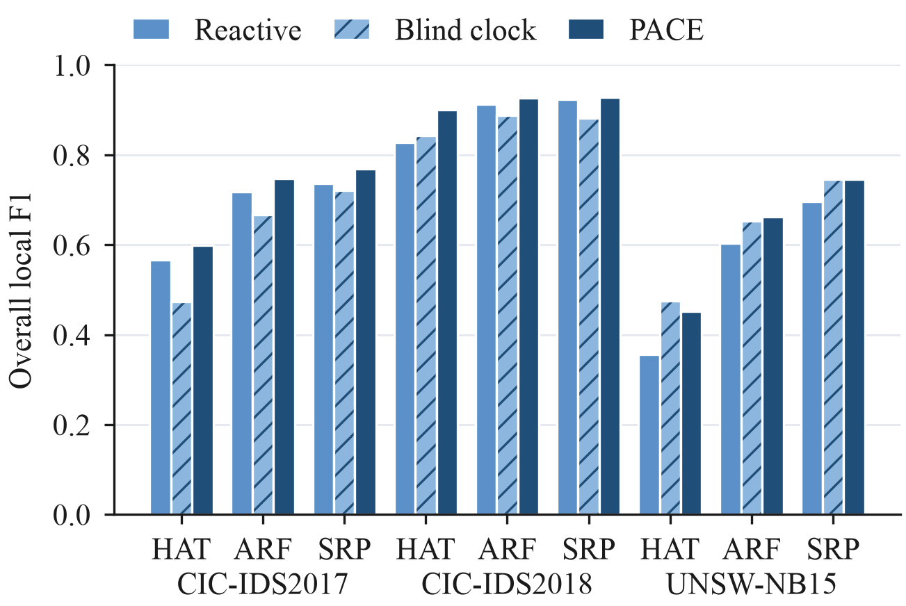
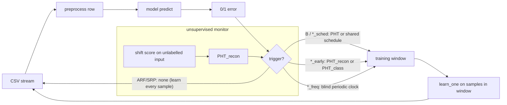
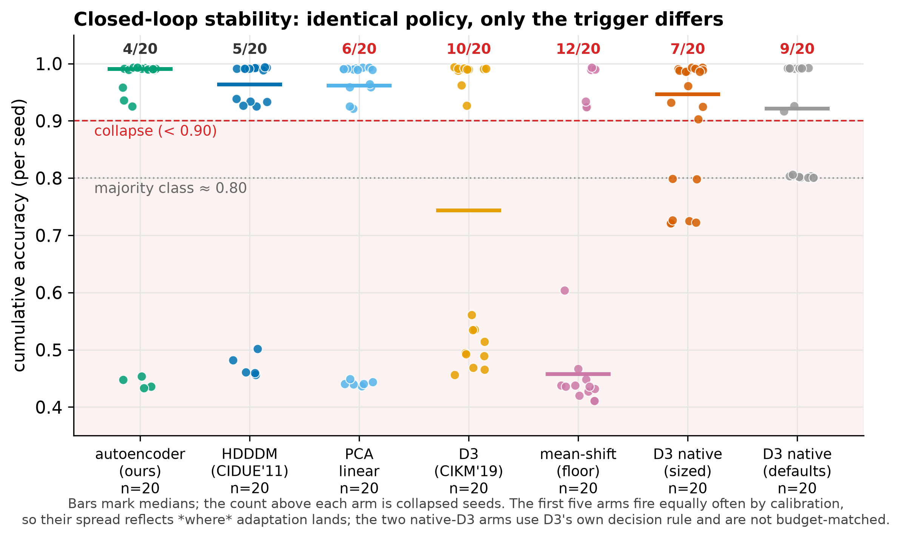

# PACE Drift — *When to retrain* a network intrusion detector: timing, triggers and closed-loop collapse

**PACE** — *Proactive Adaptation via Covariate-shift Estimation*.

**Abstract.** Streaming intrusion detectors degrade as attack traffic drifts away from the distribution they were trained on, and the standard remedy — retraining once classification error rises — inherits the delay of labelled feedback. This project treats **when to adapt** as a design decision in its own right. PACE is an unsupervised trigger: a monitor watches the reconstruction error of *incoming traffic* and initiates adaptation before the error signal responds, with learning confined to short triggered windows instead of continuous supervision. The claim is validated prequentially on three intrusion-detection datasets (CICIDS2017, CIC-IDS2018, UNSW-NB15) × three streaming learners (HAT, ARF, SRP), 10 seeds each, under **budget-matched controls** that separate adaptation *timing* from adaptation *frequency* and from *model capacity*. Against a replayed reactive schedule PACE improves sustained detection quality in all nine cells, and a frequency-matched blind clock isolates timing as the cause on CICIDS2017/2018 — but a live reactive control, the same error test run on each learner's own predictions, matches PACE there with fewer labels, so the monitor's own contribution is not resolved. A final experiment argues that trigger quality must be judged by **closed-loop stability** rather than detection accuracy, and reports an uncomfortable finding in that frame: at matched fire count over 20 seeds, *every* trigger tested — ours, two published unsupervised detectors and two cheap statistics — intermittently drives the learner into a catastrophic false-positive regime, through a training-distribution mechanism that detection metrics and final-window F1 both conceal. See [Results](#8-results).


## Key results at a glance

- **Against the replayed reactive schedule the proactive trigger wins everywhere** — swapping the shared reactive schedule (recorded once from HAT at seed 0) for the unsupervised covariate-shift trigger improves sustained local F1 in **all 9 (dataset × base-learner) cells** over 10 seeds each; aggregated, **+0.043 [95% CI +0.021, +0.065]** (sign test p=0.0039). The paired CI excludes 0 in **7/9 cells — every ensemble cell**, five of them with 10/10 seeds agreeing (Wilcoxon p=0.002); the two exceptions are the high-variance HAT cells. It holds under imbalance-aware κ in all nine.
- **It is timing, not just frequency** — against a blind periodic clock firing the *same number of times* in every cell, the timing component carries the aggregate (**+0.042 [+0.008, +0.077]** vs +0.001 for frequency), positive with a CI excluding 0 in 7/9 cells (with datasets as clusters the aggregate interval widens to [−0.003, +0.084], so the per-cell evidence carries it); on CIC-IDS2018 adapting more on a blind schedule actively *hurts* (0.881 vs the sparser reactive 0.924). A controlled synthetic stream, whose drift structure is known by construction, reproduces the advantage at an exactly matched budget (**+0.254 / +0.288** with the PCA / AE monitor, 10 seeds), where the monitor again adds only ~+0.02 over the live error test.
- **But the timing comes mostly from the live error test, not the monitor** — run live on each learner's own predictions with no monitor (`B_pht` / `ARF_pht` / `SRP_pht`), the error test PACE runs alongside its monitor matches PACE in 5 of 6 cells on CIC-IDS2017/2018 with a third to a half of the labels. The monitor's own contribution is **+0.021 [−0.002, +0.045] — not resolved**; it is significant only on the UNSW ensembles, where it adds firings and a blind clock at the same count does as well. On UNSW-NB15 the benefit is adaptation *frequency*, not timing; no mechanism for the per-dataset split is claimed.
- **The adaptation loop is fragile, and detection metrics do not show it** — at matched fire count over 20 seeds, *every* trigger tested drives the learner into a degenerate regime on a fifth to three-fifths of runs: autoencoder **4/20**, HDDDM 5/20, PCA 6/20, D3 (CIKM'19) 10/20, mean-shift 12/20. Badly placed windows feed it up to **0.46 attack fraction against a 0.20 base rate**, skewing its prior until the false-positive rate reaches **0.60–0.70**. Our monitor is *not* measurably more stable than the published detectors — only the trivial mean-shift floor separates (p=0.022).
- **An adversary can induce the collapse, and window rebalancing stops it** — on HAT / CIC-IDS2017 over 20 seeds, feature-space chaff (1.6% of traffic, clean labels) collapses PACE **14/20** and the live error test **15/20** (vs 4 and 8): label-driven triggers are no harder to steer. Replaying stored labelled flows so each triggered window teaches the pretraining attack share (`rebalance_prior`) removed **every** collapse (0/140, natural and adversarial) and lifted local F1 by +0.13 to +0.24 at no label cost. See [experiments/10](docs/experiments/10-security.md).
- **Timing needs fresh labels** — with every label held back 1,000, 5,000 or 50,000 flows (about 1, 5 and 45 minutes of capture), the timing advantage over a blind clock *matched on labelled share* (+0.053 to +0.123 with immediate labels) shrinks at 1 minute (resolved only on the ensembles, +0.037 and +0.020), disappears at 5 minutes, and at 45 minutes the clock wins in 3 of 4 cells (−0.014 to −0.077; HAT/ARF × CIC-IDS2017/2018, 10 seeds). The monitor beats the error test under delay only on ARF at 45 minutes, by labelling more, and the clock with those labels does better. Collapse is confined to the tree: an online logistic regression never collapsed (0/120, chaff included; benign FPR 3–5%). See [experiments/11](docs/experiments/11-delay-and-linear.md).
- **Model capacity beats supervision volume** — budget-matched to ~233 sparse adaptations, ensembles lead a single tree by ~+0.15 sustained F1, while continuous supervision (~2M updates) adds only ~0.05–0.07 on top. The practical recipe is **ensemble + gated adaptation on a live error test**.
- **Sub-millisecond cost** — the monitor is a linear-algebra pass on a small buffer; p95 latency stays under 0.5 ms/sample.



📄 **Start here:** [the central idea](docs/paper/idea-central.md) (what is claimed and on what evidence) · [related work & the unsupervised comparator](docs/paper/related-work.md) · [per-experiment analysis](docs/experiments/) · [architecture](docs/architecture.md) · [methodology](docs/methodology.md).

## 1. Motivation

Network intrusion detection systems trained offline face non-stationary traffic: new attack campaigns, tool variants and scanning behaviours shift the input distribution (covariate drift) and the input→label relation (real drift). A frozen model silently decays; error-based detectors (Page-Hinkley, ADWIN) react only *after* misclassifications accumulate — precisely the window in which attacks go undetected. Labels are also the scarce resource in a real deployment: continuous supervision is the one thing you cannot assume.

That makes **when to adapt** the interesting lever. A signal computed from *unlabelled input* can fire before the error signal does, and adaptation can be confined to short windows around those firings. The questions this repository answers experimentally are: does that help, is it *timing* or merely *more often*, does it survive on strong models, and what makes a good trigger.

## 2. Contributions

1. **An unsupervised *when-to-adapt* policy** — a reconstruction-error monitor over incoming traffic feeding a dual (recon + class) Page-Hinkley trigger, with learning gated to triggered windows. (`src/driftgan/early/`)
2. **Controls that isolate the mechanism** — a frequency-matched blind clock at identical fire count separates *timing* from *frequency* (`C_freq`, `ARF_freq`, `SRP_freq`); budget-matched ensembles separate *model capacity* from *continuous supervision* (`ARF_sched`, `SRP_sched`); a live reactive control separates the monitor from the error test it runs alongside (`B_pht`, `ARF_pht`, `SRP_pht`).
3. **Closed-loop stability as the criterion for trigger quality** — monitors compared by what they do to the learner (collapse rate, false-positive regime, the label composition of triggered windows), not by detection metrics. (`scripts/comparator_analysis.py`)
4. **Two published unsupervised detectors as external comparators** — D3 (Gözüaçık et al., CIKM 2019) and HDDDM (Ditzler & Polikar, CIDUE 2011), implemented and run at the identical protocol and matched fire count, plus D3 with its own native window and threshold. (`early/shift_monitors.py`)
5. **Cross-dataset validation** — the base-learner × trigger 2×2 replicated on CIC-IDS2018 and UNSW-NB15, with dataset selection driven by a label-ordering diagnostic. (`scripts/scan_drift_window.py`)
6. **Inferential rigour** — paired-t and bootstrap CIs per cell, prequential Kappa-M/Temporal, per-event stratification of anticipated vs reactive drifts. (`scripts/tier0_analysis.py`)
7. **A controlled synthetic stream** — the core timing claim reproduced where the drift process is known by construction rather than inferred from a capture. (`scripts/synthetic_timing.py`)
8. **Shared drift schedule and per-event recovery protocol** — identical adaptation indices across compared phases make per-event pairing valid; RT/AUD/min-F1/no-recovery with explicit handling of F1-undefined windows. (`drift/schedule.py`, `metrics/recovery.py`)
9. **A security evaluation** — an oracle and a chaff adversary steering the trigger, and a window-rebalancing defence. (`scripts/adversary_schedule.py`, `scripts/security_analysis.py`, `models/rebalance.py`)
10. **Label delay and a linear learner** — labels held back a fixed number of flows (`label_delay`), with count- and label-matched blind clocks, and an online logistic regression (`LR_*`). (`scripts/delay_analysis.py`)
10. **Reproducibility & cost accounting** — multi-seed CLI, manifests (git/config/CSV hashes), per-component latency breakdown and RSS tracking.

## 3. Related work

The monitor belongs to the **unsupervised / feature-space drift detection** family, and the contribution is positioned as the *policy*, not the detector. Full treatment, including verification status of every citation, in **[docs/paper/related-work.md](docs/paper/related-work.md)**.

- **Supervised (error-based) detection** — the reactive arm we improve on: Page-Hinkley (Page, 1954); DDM (Gama et al., 2004); ADWIN (Bifet & Gavaldà, *SDM* 2007); KSWIN (Raab et al., *Neurocomputing* 2020). ADWIN and KSWIN are run here as baselines and do not beat plain PHT.
- **Unsupervised / feature-space detection** — the closest family: D3 (Gözüaçık et al., *CIKM* 2019), used as our comparator; HDDDM (Ditzler & Polikar, *IEEE CIDUE* 2011); autoencoder reconstruction error (Jaworski et al., *ICAISC* 2020). Surveys: Gemaque et al. (*WIREs DMKD* 2020); Lu et al. (*IEEE TKDE* 2019).
- **Adaptive stream learners** — Hoeffding Adaptive Tree (Bifet & Gavaldà, *IDA* 2009); Adaptive Random Forest (Gomes et al., *Machine Learning* 2017); Streaming Random Patches (Gomes, Read & Bifet, *ICDM* 2019).
- **Drift in network intrusion detection** — CICIDS2017 (Sharafaldin et al., 2018) is the standard testbed precisely because its attacks arrive in temporal blocks; recent drift-aware NIDS work triggers on error or reports end accuracy without separating timing, frequency and capacity — the methodological gap this work targets.

> **Stated plainly:** monitoring autoencoder reconstruction error to detect drift already exists. The signal is not novel; the *policy*, the controls that isolate its mechanism, and the closed-loop stability criterion are the contribution.

## 4. Methodology

One prequential engine (`src/driftgan/experiments/runner.py`) runs every phase; phases differ only in **model**, **trigger** and **monitor**:



**The contribution and its controls** — the comparisons that carry the claim:

| Phase | Model | Trigger | Isolates |
|---|---|---|---|
| B / `*_sched` | HAT / ARF / SRP | PHT / shared schedule | reactive baseline (error-driven) |
| `C_early` / `ARF_early` / `SRP_early` | HAT / ARF / SRP | dual PHT (recon + class) | **the proactive policy** |
| `C_freq` / `ARF_freq` / `SRP_freq` | HAT / ARF / SRP | blind periodic clock, matched count | adaptation *timing* vs *frequency* |
| `B_pht` / `ARF_pht` / `SRP_pht` | HAT / ARF / SRP | PHT live on the learner's own error | the monitor vs a live reactive trigger |
| `ARF` / `SRP` | ensemble | none (continuous learning) | upper bound at full supervision |
| `C_early_pca` / `_mean` / `_hdddm` / `_d3` | HAT | dual PHT, monitor swapped | which shift signal makes a good trigger |
| `B_adwin` / `B_kswin` | HAT | ADWIN / KSWIN | drift-detector choice |

Details: [architecture.md](docs/architecture.md) (component design) · [methodology.md](docs/methodology.md) (protocol: schedules, recovery semantics, statistics).

## 5. Datasets

Three CICFlowMeter-family, naturally-drifting network captures. None is included in this repository; set `csv_path` in `configs/base.yaml` or the per-dataset profile in `configs/datasets/`.

| Dataset | Window used | Why |
|---|---|---|
| **CICIDS2017** (anchor) | 2M samples from row 540,000 | attacks arrive in temporal blocks after a benign prefix |
| **CIC-IDS2018** | 3M samples from row 11,000,000 | richest attack-diversity block (selected by `scripts/scan_drift_window.py`) |
| **UNSW-NB15** | 1.7M samples from row 1,750,000 | different attack taxonomy; drift is benign↔attack bursts |

Preprocessing per row: drop identifier columns (Flow ID, IPs, Timestamp), coerce features to float, replace ±inf/NaN with 0, binarize the label to BENIGN/ATTACK while keeping the raw subtype for the label-derived schedules. IoT candidates (CICIoT2023, Edge-IIoTset) were **rejected** by a label-ordering diagnostic — one is fully shuffled (no temporal drift), the other class-sorted (covariate shift and label change coincide, so there is nothing to anticipate).

## 6. Experimental protocol

- **Shared schedule**: pass 0 (Phase B dynamics) records PHT fire indices → scheduled phases replay them, making per-event pairing valid; a report-only PHT measures detection delay. The `*_early` phases are exempt by design (their claim is anticipation).
- **Seeds**: 5 per phase (`--seeds 0,1,2,3,4`), seeding python/numpy/torch/model/monitor.
- **Metrics**: rolling F1 (window 5,000) snapshotted every 500 samples; *overall local F1* = mean valid-window F1 (windows with no positive label are undefined and excluded, never counted as 0); per-event RT/AUD/min-F1/no-recovery; anticipation lead time and false-alarm rate; prequential Kappa-M and Kappa-Temporal; latency percentiles and peak RSS.
- **Statistics**: paired-t and percentile-bootstrap 95% CIs paired by seed; Wilcoxon signed-rank paired by drift index; Cliff's delta. Under bimodal outcomes (see §8, experiment 7) per-seed values and collapse counts are reported instead of a mean ± CI, which would be misleading.
- **Calibration discipline**: every monitor's PHT threshold is calibrated on its own cached score series to match the reference fire count, so arms differ in the *signal*, not in how often they fire.

## 7. Reproducing the results

```bash
git clone git@github.com:antoniol00/pace-drift.git && cd pace-drift
make setup                 # creates .venv from uv.lock (needs uv)
make test                  # unit + end-to-end synthetic smoke tests
# point configs/base.yaml:csv_path at your CICIDS2017 CSV, then:
make smoke                 # 10K-sample sanity run

# CIC-IDS2017 anchor: baselines, PACE, controls, SOTA (exp 0-3)
make run-anchor

# external validity + timing-vs-frequency decomposition (exp 5, 6).
# Calibrated intervals live in configs/datasets/*.yaml — never pass them as flags.
make schedule-2018 && make run-2018
make schedule-unsw && make run-unsw

# monitor ablation and published comparators (exp 2, 7).
# 20 seeds: the collapse outcome is bimodal.
make run-comparators

# the controlled stream (exp 8)
uv run python -m scripts.synthetic_timing --all

# analyses and figures
make analyse    # tier0 (CIs, Kappa, stratification), tier1, comparator stability
make figures    # fig1, 3, 6, 8-13, 15 + fig4/fig5 resources & sensitivity
make report     # 2017 anchor tables
```

Each run writes `results/runs/[<dataset>/]<phase>/seed_<s>/` with `manifest.json` (git hash, config hash, CSV SHA-256, package versions), `snapshots.parquet`, `drift_events.json`, `cost.json`, `trace.csv.gz`, plus per-event recovery under `results/recovery/`. `results/` is gitignored.

## 8. Results

### 8.1 The proactive trigger across datasets and learners

Overall local F1, reactive → proactive, 10 seeds ([experiment 5](docs/experiments/05-external-validity.md)):

| Base learner | CICIDS2017 | CIC-IDS2018 | UNSW-NB15 |
|---|---|---|---|
| HAT | 0.567 → 0.599 (+0.032) | 0.828 → 0.899 (+0.071) | 0.355 → 0.452 (+0.097) |
| ARF | 0.717 → 0.747 (+0.030) | 0.913 → 0.926 (+0.012) | 0.603 → 0.662 (+0.059) |
| SRP | 0.737 → **0.768** (+0.032) | 0.924 → 0.929 (+0.005) | 0.697 → **0.745** (+0.048) |

Positive in all 9 cells against the replayed schedule, at a labelled share of 21–29% vs 25.5% on CICIDS2017 but 32–33% vs 8.9% on CIC-IDS2018 and 43–50% vs 32.4% on UNSW-NB15. Under paired CIs over 10 seeds ([experiment 6](docs/experiments/06-timing-vs-frequency.md)) the CI excludes 0 in **7/9 cells — every ensemble cell** — and the two exceptions are the high-variance HAT ones. Aggregated over cells: **+0.043 [+0.021, +0.065]**. Prequential Kappa-M and Kappa-Temporal are positive in all nine.

### 8.2 Timing or just frequency — and is it the monitor?

A blind periodic clock, fire-count matched to the proactive arm in **every** cell, splits the reported gain into a frequency part (`freq − sched`) and a timing part (`early − freq`) ([experiment 6](docs/experiments/06-timing-vs-frequency.md)). Over the nine cells: reported **+0.043 [+0.021, +0.065]** = frequency **+0.001 [−0.049, +0.050]** + timing **+0.042 [+0.008, +0.077]**. Timing wins in all six CIC-IDS2017/2018 cells (+0.038 to +0.126), frequency on the UNSW-NB15 ensembles, and the UNSW HAT cell is unresolved. The control is conservative: the clock's windows never overlap, so at a matched count it learns from more labels than PACE in every cell.

A **live reactive control** then asks which part of PACE does the informing. It runs PACE's error test on each learner's own predictions with no monitor, instead of replaying the schedule recorded from HAT at seed 0:

| Dataset | Learner | F1 sched / live / PACE | labels % live / PACE | **Δ monitor** (PACE − live) |
|---|---|---|---|---|
| CIC-IDS2017 | HAT | 0.567 / 0.547 / 0.599 | 21.7 / 29.1 | +0.052 [−0.037, +0.140] |
| CIC-IDS2017 | ARF | 0.717 / 0.749 / 0.747 | 13.5 / 25.1 | −0.002 [−0.019, +0.015] |
| CIC-IDS2017 | SRP | 0.737 / 0.767 / 0.768 | 8.9 / 21.3 | +0.001 [−0.015, +0.017] |
| CIC-IDS2018 | HAT | 0.828 / 0.906 / 0.899 | 10.5 / 32.9 | −0.007 [−0.028, +0.014] |
| CIC-IDS2018 | ARF | 0.913 / 0.925 / 0.926 | 10.5 / 32.3 | +0.000 [+0.000, +0.001] |
| CIC-IDS2018 | SRP | 0.924 / 0.932 / 0.929 | 9.7 / 32.3 | −0.003 [−0.005, −0.001] |
| UNSW-NB15 | HAT | 0.355 / 0.427 / 0.452 | 33.4 / 50.4 | +0.025 [−0.099, +0.148] |
| UNSW-NB15 | ARF | 0.603 / 0.584 / 0.662 | 26.6 / 44.5 | **+0.078** [+0.070, +0.086] |
| UNSW-NB15 | SRP | 0.697 / 0.697 / 0.745 | 26.1 / 43.4 | **+0.048** [+0.036, +0.060] |

Aggregate Δ monitor **+0.021 [−0.002, +0.045]: not resolved.** Informed placement beats blind placement, but on real traffic with immediate labels the informing is done mostly by the live error test; where the monitor does add (UNSW ensembles) it adds firings, and a blind clock at the same count does as well. On a controlled stream whose drift structure is known by construction, monitor-driven timing beats a blind clock at an exactly matched budget: **+0.254 [+0.106, +0.401]** (PCA) and **+0.288 [+0.157, +0.419]** (AE), but beats the live error test by only ~+0.02 ([experiment 8](docs/experiments/08-synthetic-timing.md)).

### 8.3 What makes a good trigger: closed-loop stability

All monitors share the pipeline, learner and policy, each calibrated to the same fire count, over **20 seeds** ([experiment 7](docs/experiments/07-unsupervised-comparator.md)):

| Monitor | collapsed seeds | Fisher vs AE | FPR med / worst | train atk% |
|---|---:|---:|---:|---:|
| autoencoder | 4/20 | — | 0.006 / 0.662 | 0.26 |
| HDDDM (CIDUE'11) | 5/20 | 1.000 | 0.005 / 0.603 | 0.31 |
| PCA linear | 6/20 | 0.716 | 0.006 / 0.689 | 0.37 |
| **D3** (CIKM'19) | 10/20 | 0.096 | 0.225 / 0.595 | 0.36 |
| mean-shift (floor) | 12/20 | **0.022** | 0.609 / 0.700 | 0.46 |



**The finding is fragility, not a ranking.** *Every* trigger — two published detectors, two cheap statistics and ours — collapses the loop on a substantial fraction of seeds, and our monitor is not measurably more stable than the published alternatives (pooled 4/20 vs 33/80, p=0.119). Only the trivial mean-shift floor separates, so the signal matters at the bottom end but not between the sophisticated ones.

**Mechanism (verified, not hypothesised).** Badly placed triggers open training windows over attack-dense stretches, feeding the learner up to **0.46 attack fraction against a 0.20 base rate**; its prior skews toward ATTACK, the worst-case false-positive rate on benign traffic reaches **0.60–0.70**, the class-PHT then fires constantly and adaptation runs away. `train atk%` broadly tracks the collapse count across monitors. Running D3 with its **own** window and threshold does not rescue it — 9/20 collapses at the released defaults, 7/20 with a window sized for the data — and at those defaults it fires ~12 300 times against our 188, because with a 10-sample "new" window its 2-fold AUC crosses τ on ~5% of tests over a *stationary* stream (unit-tested).

**Metric caveat:** final-window F1 masks mid-stream collapse (one PCA seed: final F1 0.948, cumulative accuracy 0.444, FPR 0.657), so cumulative accuracy and FPR must be read alongside it. PCA matches the autoencoder on stability as well as on detection quality, so the deployable recipe is the **cheap linear monitor** ([experiment 2](docs/experiments/02-monitor-ablation.md)). Collapse counts are held to n ≥ 20 throughout: the outcome is bimodal, and a handful of replicates estimates its rate badly.

### 8.4 State-of-the-art context

Self-adapting ensembles (ARF, SRP) reach 0.77–0.81 sustained F1 learning on *every* sample (~2M supervised updates). Budget-matched to the reactive baseline's ~233 triggered adaptations they still score 0.72–0.74 (vs 0.57 for the single tree on the same windows): **the ensemble lead is driven mainly by model capacity, not continuous supervision**, which adds only ~0.05–0.07. Alternative error-based detectors (ADWIN, KSWIN) do not beat plain Page-Hinkley.

Figures: `fig1` local-F1 trajectory · `fig3` lead-time & cost/benefit · `fig4` resources · `fig5` sensitivity · `fig6` frequency control · `fig7` monitor frontier · `fig8` SOTA · `fig9` monitor in-pipeline · `fig10` budget-matched SOTA · `fig11` trigger × base-learner · `fig12` external validity · `fig13` timing vs frequency · `fig15` closed-loop stability.

**Full per-experiment analysis** (question · setup · numbers · figures · honest interpretation · caveats): [docs/experiments/](docs/experiments/).

## 9. Discussion

- **The transferable idea is the policy, not the signal.** Reconstruction-error drift detection already exists; what this work adds is using it as a *when-to-adapt* trigger, the controls that separate timing from frequency and capacity, and the finding that trigger quality must be measured in the loop.
- **Judge triggers by closed-loop stability — and expect fragility.** Detection metrics say nothing about what a trigger does to the loop. Measured in the loop on HAT, every stream-responsive trigger we tested — the live error test with no monitor included (8/20) — collapses the learner on 20–60% of runs into a regime that is operationally fatal for an IDS (0.60–0.72 worst false-positive rate), caused by the trigger biasing the learner's training distribution and its false alarms feeding further retraining; a fixed replayed schedule collapses only 2/20 and the ensembles never. No paper in the unsupervised-drift literature we surveyed reports this. We could *not* show our monitor is more stable than the published alternatives.
- **Metric choice can hide failure.** Final-window F1 masked a mid-stream collapse that cumulative accuracy and FPR expose. Report a metric that can see the whole stream.
- **Bimodal outcomes need many replicates.** At n=5 the stability comparison gave a clean, significant and wrong ranking, which we published to this repository and then had to retract at n=20. Collapse-count comparisons here are held to n ≥ 20.
- **Base learner matters more than the trigger does.** Swapping the single tree for an ensemble at the same sparse budget gains ≈ +0.15 sustained F1, several times the trigger's own contribution. The two are orthogonal, and the trigger's gain survives on top of the stronger learner — which is the harder version of the claim.
- **Scope and limits.** The timing claim holds on CICIDS2017/2018; on UNSW-NB15 the benefit is frequency. Anticipation recall at the operating point is modest (~0.23). The shared schedule is derived from B's dynamics, which slightly favours B-like strategies (bounded by the label-derived schedule). Prequential evaluation assumes immediate labels — unrealistic in deployment, though all phases share the assumption, so comparisons stay internally valid. All three datasets are CICFlowMeter-family.
- **What we decline to claim is stated as clearly as what we do.** No mechanism is offered for the per-dataset timing/frequency split, and no claim is made that our monitor is more stable than published detectors — the data does not support either.

## 10. Repository structure

```
src/driftgan/
├── config.py             # YAML resolution (base ← phase ← dataset ← CLI), run dirs, hashes
├── logging.py            # JSON-line structured logging
├── data/stream.py        # streaming CSV reader + row preprocessing
├── models/
│   ├── hat.py            # HAT factory (identical hyperparams across HAT phases)
│   └── streaming.py      # model factory: HAT vs ARF/SRP ensembles
├── drift/schedule.py     # shared schedules; dynamic-PHT / detector / periodic / scheduled triggers
├── early/
│   ├── scaling.py                 # frozen per-feature standardizer + device resolution
│   ├── reconstruction_monitor.py  # autoencoder monitor
│   ├── shift_monitors.py          # PCA / KS / MMD / mean-shift + HDDDM & D3 comparators
│   └── dual_pht.py                # dual PHT + lead-time pairing
├── metrics/              # rolling (O(1) F1), recovery (RT/AUD), cost
├── experiments/          # runner (unified engine), seeding, manifest, stats
└── viz/plots.py          # stream comparison, boxplots, RT CDF, Pareto
configs/                  # base.yaml + one YAML per phase + datasets/<name>.yaml profiles
scripts/                  # analyses: tier0, tier1, comparator, monitor_ablation, reviewer;
                          # figures: paper_figures, make_report; calibrate_monitor;
                          # synthetic_timing; scan_drift_window
docs/                     # paper/ (idea-central, related-work), experiments/*.md,
                          # architecture.md, methodology.md, figures/
tests/                    # pytest: recovery, schedule/triggers, early monitors, scaling,
                          # models, stats, dataset layering, e2e
run_experiment.py         # multi-seed CLI (also builds the schedule: --build-schedule)
Makefile                  # setup / test / lint / smoke / schedule / run-* / report
```

## 11. Future work

- **Recover a generalizable efficiency claim** — cap the proactive arm's fire count to the reactive one per dataset, testing whether it still wins with *no more* adaptations (on CICIDS2017 it already uses fewer; on 2018/UNSW it fires more).
- **Raise anticipation recall** (~0.23 today) by fusing complementary shift statistics — the stability result suggests the *combination* matters more than any single signal.
- **Make stability a design target**: rebalance or reweight triggered windows so a mis-timed trigger cannot skew the learner's class prior.
- **A second published comparator** (HDDDM) and a faithful `(w, ρ)` D3 with its native threshold, to separate "this signal" from "our adaptation of it".
- **Time-based label delay and triage**: delay labels by capture time rather than flow count, and test the monitor as a labelling-priority signal rather than a retraining trigger (experiments/11 shows count-based delay erases the timing advantage).
- **A fourth dataset** (CIC-DDoS2019) and randomized attack-block ordering, to decouple results from each capture's specific sequence.

## 12. Citation

```bibtex
@misc{pacedrift2026,
  title  = {Retraining Timing and Adversarial Steering in Streaming Network
            Intrusion Detection: A Budget-Matched Evaluation},
  author = {Lara Guti\'errez, Antonio},
  year   = {2026},
  note   = {https://github.com/antoniol00/pace-drift}
}
```

## 13. License

No license file yet — all rights reserved until one is chosen. `[TODO: pick a license]`
