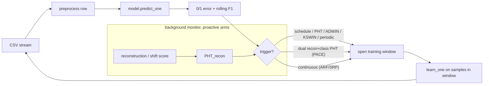

# Architecture

This document describes the architecture that all experiments share, and in which
**PACE** (*Proactive Adaptation via Covariate-shift Estimation*) is one
configuration of the trigger and monitor slots. The design goal is that **every
phase runs through one prequential engine** and differs only in a few pluggable
components, so any difference in results is attributable to those components and
nothing else. Protocol-level detail (schedule construction,
recovery-metric semantics, statistics) lives in [methodology.md](methodology.md);
the per-experiment results in [experiments/](experiments/).

## 1. One engine, three pluggable slots

`src/driftgan/experiments/runner.py:run_phase` is a single test-then-train
(prequential) loop over the stream. A phase is a choice of three slots:

| Slot | Options | Where |
|---|---|---|
| **Model** | Hoeffding Adaptive Tree · Adaptive Random Forest · Streaming Random Patches | `models/streaming.py:make_model` |
| **Trigger** | shared schedule · dynamic PHT · ADWIN/KSWIN detector · blind periodic clock (`*_freq`) · dual (recon+class) PHT · continuous (learn every sample) | `drift/schedule.py`, runner |
| **Monitor** | none · autoencoder · PCA reconstruction · KS · MMD · mean-shift · HDDDM · D3 (published comparators) | `early/`, `_make_monitor` |

The **trigger** slot is where the research contribution lives: the study is about
*when* adaptation fires. The blind periodic clock exists solely as its control —
firing the same number of times on no signal at all — and the monitor slot exists
to ask which unlabelled signal makes a good trigger (see
[experiment 7](experiments/07-unsupervised-comparator.md): monitors that detect
comparably do **not** trigger comparably).

The loop only calls `model.learn_one` **inside a triggered window** (except the
continuous ARF/SRP phases, which learn on every sample). This is the key design
decision behind the whole study: adaptation is a *scarce, triggered* action, so
the interesting questions are **when to adapt** and **how good a single adaptation
is** — not "keep learning forever".

## 2. Components

### Models (`models/`)
- **Hoeffding Adaptive Tree (HAT)** — the single-tree base learner used by the
  core phases; identical hyper-parameters across phases (`models/hat.py`).
- **Adaptive Random Forest (ARF)** and **Streaming Random Patches (SRP)** —
  state-of-the-art streaming ensembles, dispatched by phase-name prefix so that
  budget-matched (`*_sched`) and early-triggered (`*_early`) variants reuse them
  (`models/streaming.py`).

### Triggers (`drift/schedule.py`)
- `ScheduledDriftTrigger` — replays a fixed list of indices (the shared schedule)
  so scheduled phases adapt at identical events and can be paired event-by-event.
- `DynamicPHTTrigger` — a live Page-Hinkley test on the 0/1 error.
- `DynamicDetectorTrigger` — the same idea generalised to any river detector
  (ADWIN, KSWIN).
- `PeriodicTrigger` — a blind fixed-period clock (the frequency-matched control).
- `DualPHT` (`early/dual_pht.py`) — two Page-Hinkley tests, one on the classifier
  error (reactive) and one on the monitor's score (**anticipatory**); either can
  fire adaptation, and the pairing of the two fire streams yields the lead-time
  analysis.

### Monitors (`early/`)
Background covariate-shift detectors sharing one protocol: a **frozen reference
frame** set on the first check, then, on every later check, **score before
updating the reference** so a distribution change shows up as a *leading* spike.
`shift_monitors.py` holds the cheap statistics (PCA reconstruction, KS, MMD,
mean-shift) and the published comparators — **HDDDM** (Ditzler & Polikar, CIDUE
2011) and **D3** (Gözüaçık et al., CIKM 2019), the latter also with its own native
window and threshold — while `reconstruction_monitor.py` holds the autoencoder.
All share the identical protocol, so arms differ in the *signal* and nothing
else, and each one's Page-Hinkley threshold is calibrated to a common fire count
(`scripts/calibrate_monitor.py`).

Sharing the protocol is what makes the monitor slot a fair experiment, and it
produced the study's least expected result. Because the monitor decides *where*
training windows open, a mis-placed signal skews the label composition the learner
is fed and can collapse it into a high-false-positive regime — and at matched fire
count this happens to **every** trigger tested, published detectors included, on a
substantial fraction of runs. Monitors must therefore be judged by closed-loop
stability rather than detectability
([experiment 7](experiments/07-unsupervised-comparator.md)).

### Metrics (`metrics/`)
Rolling O(1) F1, per-event recovery (RT / AUD / min-F1 / no-recovery with
explicit handling of F1-undefined windows), and a cost tracker (per-sample
latency percentiles + named component sections + RSS). See
[methodology.md](methodology.md) §2 and §5.

## 3. Phase taxonomy

One YAML per phase (`configs/phase_*.yaml`), merged over `configs/base.yaml`.

| Group | Phases | Model | Trigger | Purpose |
|---|---|---|---|---|
| Reactive baselines | `B`, `B_adwin`, `B_kswin` | HAT | PHT / ADWIN / KSWIN | the arm PACE must beat, and evidence that detector choice is not the lever |
| PACE | `C_early`, `ARF_early`, `SRP_early` | HAT / ensemble | dual recon+class PHT | the proposal, on each base learner |
| Frequency controls | `C_freq`, `ARF_freq`, `SRP_freq` | HAT / ensemble | blind periodic clock | isolates timing from frequency |
| Budget-matched SOTA | `ARF_sched`, `SRP_sched` | ensemble | shared schedule | isolates model capacity from supervision |
| Continuous SOTA | `ARF`, `SRP` | ensemble | continuous | upper reference |
| Monitor ablation | `C_early_pca`, `C_early_mean`, `C_early_ks`, `C_early_mmd` | HAT | dual, cheap monitor | how cheap can the signal be |
| Published comparators | `C_early_hdddm`, `C_early_d3`, `C_early_d3_native`, `C_early_d3_sized` | HAT | dual / native | do published detectors trigger as well |

### Dataset profiles (`configs/datasets/`)
The engine itself is dataset-agnostic: feature dimensionality/order is
inferred from the first row's keys, and `models/`, `drift/` and `early/` never
hardcode a column name or count. What *is* dataset-specific —
CSV path, target/benign-label strings, dropped identifier columns, the
drift-rich evaluation window (`start_row`/`max_samples`), and the monitor's
recon Page-Hinkley threshold — lives in a per-dataset YAML profile
(`configs/datasets/<name>.yaml`), selected by a `--dataset <name>` flag on
`run_experiment.py` and merged `base.yaml ← phase yaml ←
configs/datasets/<name>.yaml ← CLI` (`config.py`) — the dataset profile is the
most-specific non-CLI layer, so it overrides a phase yaml's defaults (e.g. a
per-dataset monitor threshold wins over the phase's calibrated-on-2017 value). A
profile's `by_phase:` block carries values calibrated per *(dataset, phase)* pair,
such as the blind clock's interval, and is applied after the dataset layer.
Results are namespaced by dataset —
`results/runs/<dataset>/<phase>/seed_<n>/` and
`results/recovery/<dataset>_<phase>_<seed>.parquet` — except the default
`cicids2017`, which keeps the original flat paths
(`results/runs/<phase>/seed_<n>/`, `results/recovery/<phase>_<seed>.parquet`)
so existing 2017 results are neither moved nor rerun. See
[experiment 5](experiments/05-external-validity.md) for the two profiles
(`cicids2018.yaml`, `unsw.yaml`) built on this slot.

## 4. Reproducibility

Every `(phase, seed)` run writes `results/runs/<phase>/seed_<n>/` with a
`manifest.json` (git commit, config hash, CSV SHA-256, package versions),
`snapshots.parquet` (rolling F1/acc every 500 samples), `drift_events.json`,
`cost.json`, `trace.csv.gz`, and a per-event recovery parquet under
`results/recovery/`. Seeds fix `random`/`numpy`/`torch` and the model. Config
lives entirely in YAML — no experiment constant is hard-coded in a module.
