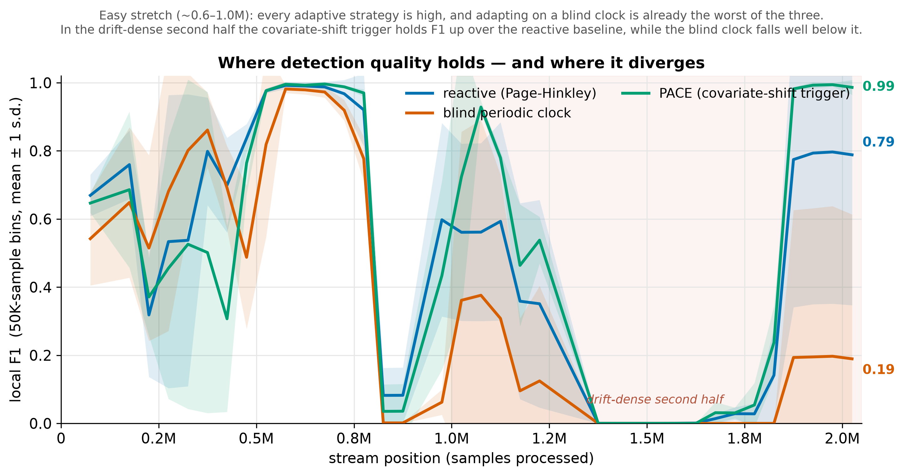
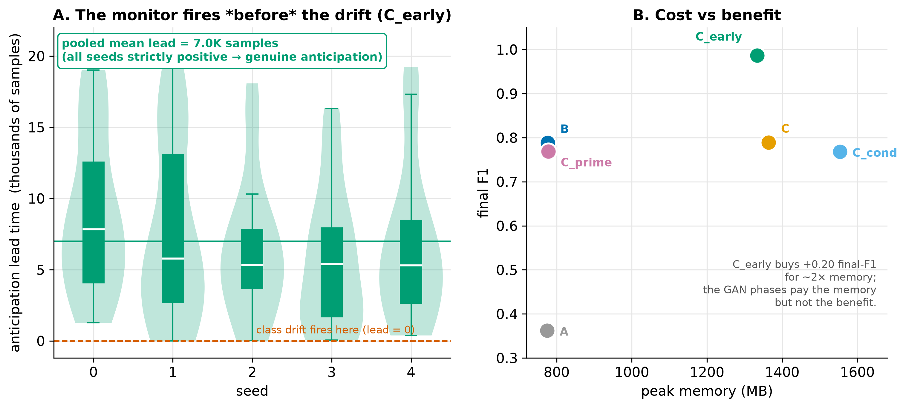

# Experiment 0 — The core result: reactive vs proactive adaptation

## Question

An intrusion detector that retrains when its error rises inherits the delay of
labelled feedback. Can an **unsupervised** monitor over the incoming traffic
trigger adaptation *earlier*, and does adapting earlier actually pay?

## Setup

CIC-IDS2017, ~2M samples, HAT base learner, 10 seeds.

- **Reactive baseline (`B`)** — Page-Hinkley over the classification error opens a
  short training window when the error degrades. It replays a shared drift
  schedule (233 fire indices from a pass-0 run) so per-event metrics can be
  paired across arms.
- **PACE (`C_early`)** — schedule-exempt by construction: its claim is
  *anticipation*, which a fixed schedule would erase. A dual Page-Hinkley watches
  both the classification error and the reconstruction error of an unsupervised
  monitor over the unlabelled input; either can open the window.

Both confine learning to short triggered windows, so neither sees continuous
supervision. `make run-reactive run-pace`.

## Results

| arm | adaptations | labels | final F1 | overall local F1 |
|---|---:|---:|---:|---:|
| reactive (`B`) | 233 | 25.5% | 0.883 | 0.567 |
| reactive, live (`B_pht`) | 161 | 21.7% | 0.978 | 0.547 |
| **PACE (`C_early`)** | **169** | 29.1% | **0.987** | **0.599** |

`labels` is the share of the evaluated stream whose labels reached the learner.
A firing opens a 5,000-sample window and a firing inside an open window restarts
it, so the reactive arm's clustered firings share windows: PACE fires less but
learns from slightly *more* labels. `B` replays the schedule recorded from HAT at
seed 0; `B_pht` runs the same error test live on each seed's own predictions
([experiment 6, Part C](06-timing-vs-frequency.md#part-c--live-reactive-control-new-runs)).

Overall local F1 is the primary metric — the mean F1 over valid rolling windows,
excluding windows with no positive label rather than scoring them zero. The
single final-window F1 is noisy and a cumulative mean washes out precisely the
drift-dense regions where the arms diverge.

PACE reaches higher sustained quality with **fewer** adaptations, at a similar
label budget (29.1% vs 25.5%). Against the live control the gap is +0.052, with a
CI that includes 0 at ten seeds ([−0.037, +0.140]).

### Where quality holds and where it diverges

In the easy stretch (~0.6–1.0M) the arms are close. The separation is
concentrated in the drift-dense second half, which is what the aggregate hides
and why the segment view is reported alongside it.

### The monitor genuinely anticipates

Anticipation lead times are strictly positive in each of the ten seeds (pooled mean ~7K
samples): the monitor fires *before* the classification error responds. That is
the mechanism the rest of the experiments interrogate.

## Caveats

- The advantage is **region-specific** — concentrated in the drift-dense second
  half, not uniform across the stream.
- Anticipation **recall is modest** (~0.23 at the operating point): the monitor
  foresees about a quarter of the drifts it could. Its value comes from the ones
  it does catch, not from catching all of them
  ([experiment 4](04-resources-sensitivity.md)).
- `no_recovery` is high for *both* arms (0.66 reactive, 0.72 PACE, ten seeds) — a
  property of this stream's dense, overlapping drifts rather than a failure of
  either strategy. Mean RT over recovered events is 440 samples (95% CI
  [367, 526]) reactive and 1,235 [939, 1,571] PACE; not a like-for-like speed
  contrast, since PACE's events are its own firings (schedule-exempt) and the
  recovered subsets differ at different no-recovery rates (survivorship).

**What this does not yet establish:** whether the gain comes from *when* PACE
adapts or merely from *how often* ([experiment 1](01-frequency-control.md)),
whether the monitor needs to be anything more than a cheap statistic
([experiment 2](02-monitor-ablation.md)), how any of it compares to a modern
streaming ensemble ([experiment 3](03-sota-baselines.md)), and whether the
monitor adds anything to the error test it runs alongside
([experiment 6, Part C](06-timing-vs-frequency.md#part-c--live-reactive-control-new-runs)).
