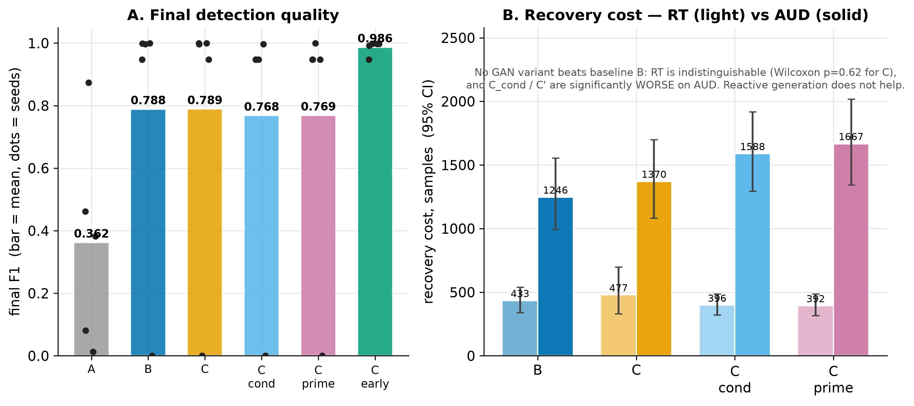

# Core run — GAN adaptation vs generative early detection

## Question

Two hypotheses from the original proposal:
1. **Adaptation** — does generating synthetic samples of a new attack at drift
   time (vanilla GAN in **C**, subtype-conditional WGAN-GP in **C_cond**) improve
   recovery over a reactive baseline that simply retrains (**B**)?
2. **Anticipation** — can a generative background monitor (**C_early**) fire
   adaptation *before* the classifier's error rises?

Controls: **A** (frozen model, lower bound) and **C'** (bootstrap+jitter, the
same synthetic-sample budget as the GAN — isolates "more samples" from "better
samples").

## Setup

5 seeds, full ~2M-sample stream. B/C/C'/C_cond replay a shared drift schedule
(233 fire indices from a pass-0 Page-Hinkley run) so per-event metrics can be
paired. C_early is schedule-exempt and runs dynamic dual (recon + class) PHT with
an autoencoder monitor. `make run-all SEEDS=0,1,2,3,4`.

## Results

| Phase | final F1 | overall local F1 | mean RT | mean AUD | no-recovery | peak RSS (MB) |
|---|---|---|---|---|---|---|
| A (frozen) | 0.362 | 0.090 | — | — | — | 775 |
| B (reactive PHT) | 0.788 | 0.573 | 433 | 1246 | 0.66 | 777 |
| C (vanilla GAN) | 0.789 | 0.526 | 477 | 1370 | 0.66 | 1364 |
| C_cond (WGAN-GP) | 0.768 | 0.474 | 396 | 1588 | 0.69 | 1554 |
| C' (bootstrap+jitter) | 0.769 | 0.432 | 392 | 1667 | 0.69 | 778 |
| **C_early** (gen. monitor) | **0.986** | **0.595** | 1094\* | 3701\* | 0.71 | 1333 |

\* C_early's RT/AUD are confounded: it adapts proactively and is schedule-exempt,
so few events pair cleanly. Its fair headline is F1 and lead time.

**Paired Wilcoxon (shared schedule).** C vs B: RT *p* = 0.62, AUD *p* = 0.62 —
statistically indistinguishable. C_cond and C' are *significantly worse* than C/B
on AUD (*p* ≈ 1e-20) but with negligible effect sizes (|Cliff's δ| < 0.07) and in
the wrong direction. The feature-scale collapse that had made the vanilla and
conditional GANs produce byte-identical output was fixed **first**, so this is a
genuine negative, not a bug.

### Where quality holds and diverges

Frozen (A) decays as drift accumulates. In the easy stretch (~0.6–1.0M) every
adaptive strategy is high and indistinguishable — the GAN even trails B early. In
the drift-dense second half only C_early holds F1 up (+0.10–0.14 over B).

### Recovery cost — no GAN variant beats the baseline

Final F1 clusters at ~0.77–0.79 for B/C/C_cond/C', with C_early alone at 0.986.
On recovery cost (RT/AUD) no GAN variant improves on B.

### The early monitor genuinely anticipates

Anticipation lead times are strictly positive across all seeds (pooled mean ~7K
samples): the recon monitor fires *before* the class error rises. C_early buys
+0.20 final F1 for ~2× memory; the GAN phases pay the memory but not the benefit.

## Interpretation

- **GAN-based adaptation is a null result.** Synthetic-sample quantity/quality
  from the GAN does not improve drift recovery over simply retraining. The
  conditional WGAN-GP gives no advantage; naive oversampling (C') actively hurts.
- **The generative early-detection monitor is the positive result.** C_early
  reaches 0.986 final F1 with real anticipation lead times, and its advantage is
  concentrated (and robust) in the drift-dense second half of the stream.

## Caveats

- C_early's advantage is **region-specific** (the dense second half), not
  uniform; in the easy stretch it ties the baseline.
- Anticipation **recall is modest** (~0.23 at the operating point — it foresees
  about a quarter of drifts; see [experiment 5/6](04-resources-sensitivity.md)).
- `no_recovery` is high (~0.66–0.71) across *all* phases — a property of the
  stream's dense, overlapping drifts, not a per-phase failure.

**Follow-ups:** the null and the modest recall motivated the reviewer
experiments — is the gain timing or frequency ([1](01-frequency-control.md))? is
the AE monitor justified ([2](02-monitor-ablation.md))? how does this compare to
SOTA ([3](03-sota-baselines.md))?
