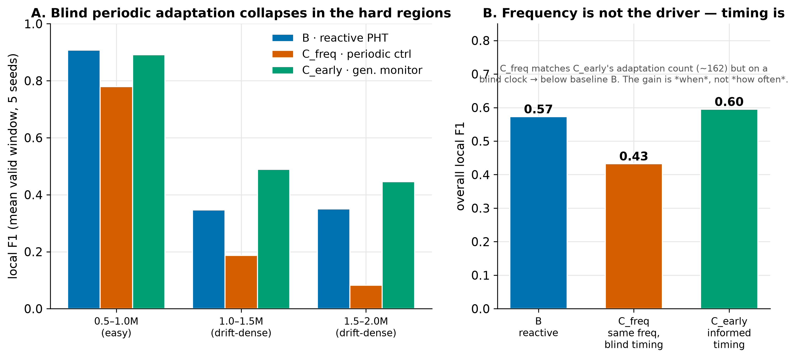

# Experiment 1 — Frequency-matched control (C_freq)

## Question

C_early beats the reactive baseline B. But C_early adapts on a schedule of its
own choosing — is its gain because of ***when*** it adapts (informed by the drift
signal) or simply because it adapts a **different number of times**? A reviewer's
first objection: *"it only helps because it retrains more often."*

## Setup

Phase **C_freq**: adapt on a **blind periodic clock** — fire every 12,000 samples
regardless of any error or drift signal — at the *same count* as C_early (~162
adaptations over the evaluated stream). Same HAT, same retrain-window mechanics,
no monitor. This isolates adaptation **frequency** from adaptation **timing**.
`make run-C-freq SEEDS=0,1,2,3,4`.

A useful fact surfaced first: B actually fires **more** than C_early (233 vs
142–171), so "it retrains more" was already weak — but C_freq tests it cleanly.

## Results

Overall local F1 by stream segment (mean over 5 seeds):

| Segment | B (reactive) | C_freq (blind, same count) | C_early (proactive) |
|---|---|---|---|
| 0.5–1.0M (easy) | 0.908 | 0.780 | 0.891 |
| 1.0–1.5M (drift-dense) | 0.346 | 0.187 | 0.489 |
| 1.5–2.0M (drift-dense) | 0.350 | 0.082 | 0.446 |
| **overall** | **0.573** | **0.433** | **0.595** |

## Interpretation

**Timing, not frequency.** Matching C_early's adaptation *count* with blind
periodic timing not only fails to reproduce its advantage — it lands **below the
reactive baseline B** (0.433 vs 0.573), collapsing in exactly the drift-dense
regions where C_early shines. So C_early's gain is entirely about adapting at the
*right moments* (informed by the drift/anticipation signal), not about adapting
more.

The mechanism is intuitive: a blind clock often opens its retrain window over a
benign or wrong-attack stretch, biasing the tree toward the wrong distribution;
the drift-triggered window lands on the samples that matter.

## Caveats

- C_freq's *final-window* F1 is unstable (0.19 mean, one seed 0.95) — this is why
  the analysis uses overall/segment local F1, not the last window.
- The count match is to C_early's mean (~162); per-seed counts vary slightly.
