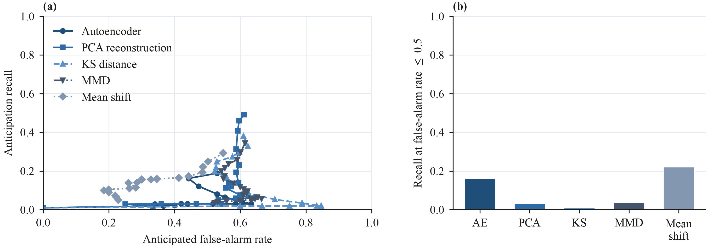
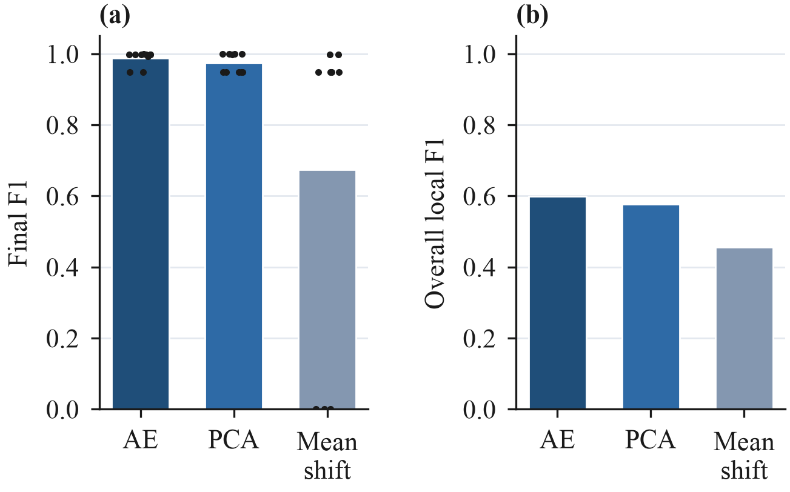

# Experiment 2 — Monitor ablation: how cheap can the signal be?

> **Read the tables here alongside [experiment 7](07-unsupervised-comparator.md).**
> This page judges monitors on *final F1*, which **masks mid-stream collapse** —
> one PCA seed shows `final_f1 = 0.948` while its cumulative accuracy is `0.444`
> and its false-positive rate `0.657`. Always check cumulative accuracy and FPR
> alongside it. Judged on closed-loop stability at 20 seeds the conclusion below
> is unchanged: PCA and the autoencoder are indistinguishable (6/20 vs 4/20
> collapses, Fisher p = 0.72).

## Question

The monitor is what makes the trigger unsupervised, so the natural question is
how much machinery it actually needs. If a **cheap covariate-shift statistic**
anticipates as well as an autoencoder, the autoencoder is not justified and the
deployable recipe is the cheap one.

## Setup

Four cheap monitors sharing the autoencoder's **exact protocol** (frozen
reference frame; score before updating the reference so a shift is a *leading*
signal): linear **PCA reconstruction**, per-feature **KS** distance, RBF **MMD**,
and a trivial **mean-shift** (L2 distance of standardized feature means).
`src/driftgan/early/shift_monitors.py`.

Two levels of comparison:
1. **Offline detectability frontier** (`scripts/monitor_ablation.py`, fig7): one
   pass per seed collects each monitor's score series; each is z-scored and swept
   with a threshold detector to trace anticipation recall vs false-positive rate,
   paired against the same class-drift fires.
2. **Full pipeline** (fig9): run the whole PACE loop with the monitor swapped in —
   phases `C_early_mean` and `C_early_pca`, with `PHT_recon` recalibrated to the
   autoencoder's fire count (`scripts/calibrate_monitor.py`). **This is the
   authoritative test** — it measures what actually matters, the downstream
   detection quality.

## Results

### Offline frontier — misleading on its own

Under a common threshold detector the autoencoder does **not** dominate; a trivial
mean-shift matches or exceeds it, and no monitor clears recall ≈ 0.5. This
*suggested* the AE was unnecessary — but the offline frontier measures raw signal
separability, not the deployed system.

### Full pipeline — the authoritative test

| Monitor in the PACE pipeline (10 seeds) | final F1 | overall local F1 |
|---|---|---|
| Autoencoder (generative) | 0.987 | 0.599 |
| **PCA reconstruction (linear)** | **0.973** | **0.577** |
| mean-shift (trivial) | 0.673 | 0.456 |

## Interpretation

**A reconstruction signal is needed, but the autoencoder is over-engineered.** In
the deployed loop, where the monitor's score dynamics interact with the
adaptation trigger, a **linear PCA reconstruction monitor nearly matches the
autoencoder** (0.973 vs 0.987 final), while a **trivial mean-shift is clearly
worse** (0.673). So the monitor must capture multivariate structure, but it need
not be non-linear: **cheap PCA suffices**, and it is far lighter to run. That is
the configuration to deploy.

**Methodological lesson:** the offline signal-separability proxy was misleading
(it favoured mean-shift); monitor changes must be confirmed in the full pipeline,
where *adaptation timing* — not raw separability — is what pays off.

## Caveats

- The offline frontier z-scores each series over the whole run (uses future
  information) — fine for characterising detectability, but it is explicitly *not*
  the deployed detector, which is why the pipeline runs are the headline.
- `C_early_ks` / `C_early_mmd` phases exist but were not run in the full pipeline;
  KS/MMD looked no better than PCA offline and are more expensive.
