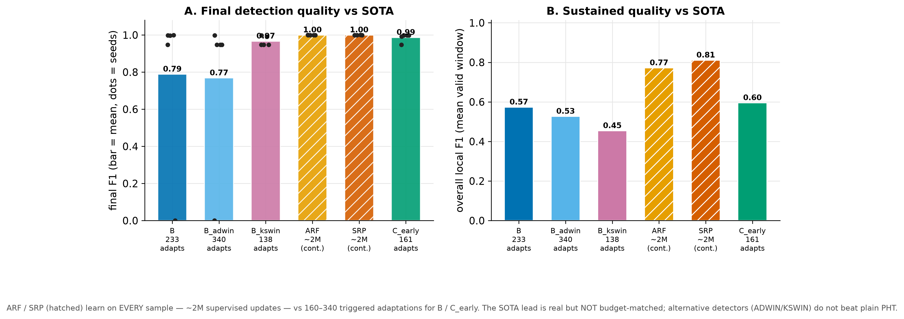

# Experiment 3 — State-of-the-art baselines

## Question

The core study compares proposals against internal controls (A/B/C'). A reviewer
will ask how C_early stacks up against **established streaming methods**: other
drift detectors, and self-adapting ensembles that are the go-to for concept-drift
classification.

## Setup

Two families:
- **Alternative drift detectors** on the same HAT: **B_adwin** (ADWIN),
  **B_kswin** (KSWIN), run dynamically (reactive) in place of Page-Hinkley.
- **Self-adapting ensembles**: **ARF** (Adaptive Random Forest) and **SRP**
  (Streaming Random Patches), run in **continuous** mode — they learn on *every*
  sample and manage drift internally (ADWIN per member), no external trigger.

`make run-sota SEEDS=0,1,2,3,4`.

## Results

| Phase | final F1 | overall local F1 | adaptations |
|---|---|---|---|
| B (PHT) | 0.788 | 0.573 | 233 |
| C_early | 0.986 | 0.595 | 161 |
| B_adwin (ADWIN) | 0.768 | 0.527 | 340 |
| B_kswin (KSWIN) | 0.966 | 0.454 | 138 |
| **ARF** (continuous) | 1.000 | 0.772 | ~2M (every sample) |
| **SRP** (continuous) | 1.000 | 0.811 | ~2M (every sample) |

## Interpretation

- **Alternative drift detectors do not help.** ADWIN and KSWIN on the HAT are
  erratic (they over- or under-fire) and land *below* plain Page-Hinkley on
  sustained F1. Detector choice is not the lever.
- **Self-adapting ensembles win on raw quality** — SRP 0.811 and ARF 0.772
  sustained, ~1.00 final, above C_early's 0.595. **But they learn on every one of
  ~2M samples** (full continuous supervision), versus 161 triggered adaptations
  for C_early. On raw F1 that is a real lead; it is not a like-for-like
  comparison, which is why the figure prints the adaptation budget under each bar.

This raised the obvious follow-up: is the ensemble lead due to **model capacity**
or **continuous supervision**? See [experiment 3b](03b-budget-matched.md).

## Caveats

- The ensembles' "0 drifts" is by construction (no external trigger; they
  self-adapt), not a failure to detect.
- ARF and especially SRP are **expensive**: SRP's p95 latency is ~11 ms/sample
  (vs sub-ms for the HAT phases) and its throughput ~130 samples/s — see
  [experiment 5/6](04-resources-sensitivity.md).
