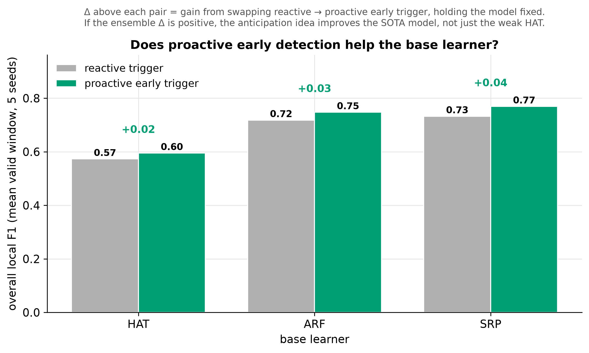

# Experiment 3 — Streaming SOTA: capacity, supervision, and the trigger

## Question

Three questions that only make sense together, so they are answered together:

1. Do **other drift detectors** do better than plain Page-Hinkley as the reactive
   arm? (If so, the baseline is a straw man.)
2. Modern self-adapting ensembles beat everything on raw quality — but they learn
   from every sample. Is that lead **model capacity** or **continuous
   supervision**?
3. Does the proactive trigger help a **state-of-the-art** base learner, or was it
   only compensating for a weak one?

## Setup

All on CIC-IDS2017, 10 seeds.

- **Alternative reactive detectors** on the same HAT: `B_adwin` (ADWIN),
  `B_kswin` (KSWIN), in place of Page-Hinkley.
- **Continuous ensembles**: `ARF` (Adaptive Random Forest) and `SRP` (Streaming
  Random Patches) learning on *every* sample, managing drift internally, with no
  external trigger.
- **Budget-matched ensembles** (`ARF_sched`, `SRP_sched`): the same ensembles
  restricted to the reactive arm's regime — adaptation only inside triggered
  windows on the shared schedule.
- **PACE on the ensembles** (`ARF_early`, `SRP_early`): the same ensembles driven
  by the proactive dual Page-Hinkley over the covariate-shift monitor.

`make run-sota run-sota-matched run-early-ensemble`.

## Results

### 1. Detector choice is not the lever

| arm | overall local F1 | adaptations |
|---|---:|---:|
| reactive, Page-Hinkley | 0.567 | 233 |
| reactive, ADWIN | 0.527 | 340 |
| reactive, KSWIN | 0.454 | 138 |

ADWIN and KSWIN are erratic — they over- and under-fire respectively — and both
land *below* plain Page-Hinkley on sustained F1. The reactive baseline is not a
straw man.

### 2. The ensemble lead is capacity, not supervision

| arm | model | overall local F1 | adaptations |
|---|---|---:|---:|
| reactive | HAT | 0.567 | 233 |
| PACE | HAT | 0.599 | 169 |
| budget-matched | ARF | 0.717 | 233 |
| budget-matched | SRP | 0.737 | 233 |
| continuous | ARF | 0.772 | ~2M |
| continuous | SRP | 0.811 | ~2M |

Two clean contrasts fall out:

- **Model capacity, at matched budget (233 adaptations):** ensembles 0.72–0.74 vs
  HAT-based 0.57–0.60 → **+0.13–0.16**.
- **Continuous supervision (233 → ~2M updates):** ARF 0.717→0.772, SRP
  0.737→0.811 → only **+0.05–0.08**.

So sparse triggered adaptation is label-efficient: the ensembles keep ~90–95% of
their continuous-learning quality on ~233 adaptations instead of ~2M.

### 3. The trigger transfers to the strongest learners

| base learner | reactive | PACE | Δ | adaptations |
|---|---:|---:|---:|---|
| HAT | 0.567 | 0.599 | **+0.032** | 233 → 169 |
| ARF | 0.717 | 0.747 | **+0.030** | 233 → 110 |
| SRP | 0.737 | 0.768 | **+0.032** | 233 → **90** |

The proactive trigger improves **every** base learner while using **fewer**
adaptations. It is therefore not a crutch for a weak single tree: it lifts the
state-of-the-art ensemble too, and more label-efficiently. The best single
configuration is **SRP + PACE = 0.768 sustained F1 on 90 adaptations**,
approaching continuous SRP's 0.811, which needs ~2M supervised updates.

## Interpretation

The transferable contribution is a cheap, model-agnostic **when-to-adapt**
signal, and the practical recipe is **ensemble + proactive triggered
adaptation**. Choosing a stronger base learner buys more than any change to the
trigger does — but the two are orthogonal, and the trigger's gain survives on top
of the stronger learner, which is the harder version of the claim.

## Caveats

- The per-cell Δ is modest (~+0.03). The strength of the result is its
  **consistency and direction** across learners at a *reduced* budget, not the
  size of any single number; [experiment 6](06-timing-vs-frequency.md) subjects it
  to paired confidence intervals across three datasets.
- The ensembles report no drift events by construction (they self-adapt
  internally); that is not a failure to detect.
- ARF and especially SRP are **expensive**: SRP's p95 latency is ~11 ms/sample
  against sub-ms for the HAT arms, at ~130 samples/s — see
  [experiment 4](04-resources-sensitivity.md).
- The monitor's anticipation recall is modest (~0.23); a higher-recall monitor
  could widen the gap, and remains an open direction.
