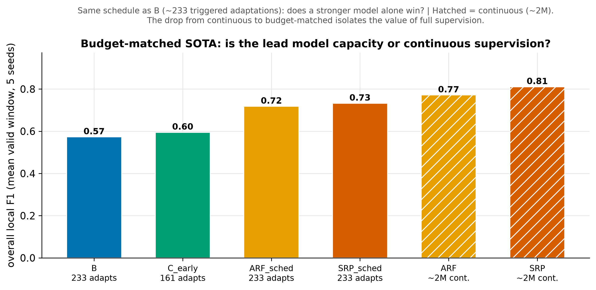

# Experiment 3b — Budget-matched SOTA

## Question

The continuous ARF/SRP ([experiment 3](03-sota-baselines.md)) beat everything —
but they use ~2M supervised updates against C_early's ~161 triggered adaptations.
Is that lead **model capacity** (ensemble vs single tree) or **continuous
supervision** (many more labels)? These are separable, and the answer decides how
to position the paper.

## Setup

Phases **ARF_sched** and **SRP_sched**: the same ensembles, but restricted to the
**same triggered regime as B** — they adapt only in retrain windows on the shared
schedule (~233 adaptations), *not* on every sample. This gives a clean 2×2 with
the model held constant across supervision levels and the budget held constant
across model families. `make run-sota-matched SEEDS=0,1,2,3,4`.

## Results

| Phase | model | overall local F1 | adaptations |
|---|---|---|---|
| B | HAT | 0.573 | 233 |
| C_early | HAT | 0.595 | 161 |
| **ARF_sched** | ensemble | **0.718** | 233 |
| **SRP_sched** | ensemble | **0.733** | 233 |
| ARF | ensemble | 0.772 | ~2M |
| SRP | ensemble | 0.811 | ~2M |

Two clean contrasts:
- **Model capacity, at matched budget (233):** ensembles 0.72–0.73 vs HAT-based
  0.57–0.60 → **+0.13–0.16**.
- **Continuous supervision (233 → 2M):** ARF 0.718→0.772, SRP 0.733→0.811 →
  only **+0.05–0.08**.

## Interpretation

**The SOTA lead is mostly model capacity, not continuous supervision.** Even
restricted to the reactive baseline's sparse ~233 adaptations, the ensembles beat
B and C_early substantially; adding full continuous supervision on top adds only a
modest amount. Two implications:

1. **C_early's bottleneck is the single HAT.** Swapping in a stronger base learner
   at the *same* sparse budget gains far more than any augmentation strategy did.
2. **Sparse triggered adaptation is label-efficient.** Ensembles keep ~90–95% of
   their continuous-learning performance with ~233 adaptations instead of ~2M —
   so "adapt only at detected drift" is a reasonable regime, and the natural place
   to carry the early-detection trigger. That is [experiment 3c](03c-early-ensemble.md).

## Caveats

- `*_sched` uses B's shared schedule (fixed 233 indices); it matches the budget
  and timing of B exactly, mirroring the existing C_early-vs-B design.
- Final F1 is ~1.00 for all ensemble variants; the discriminating metric is
  sustained (overall local) F1.
