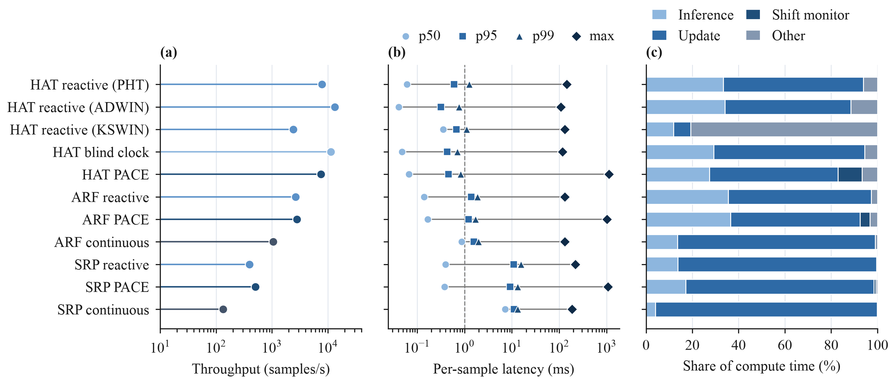
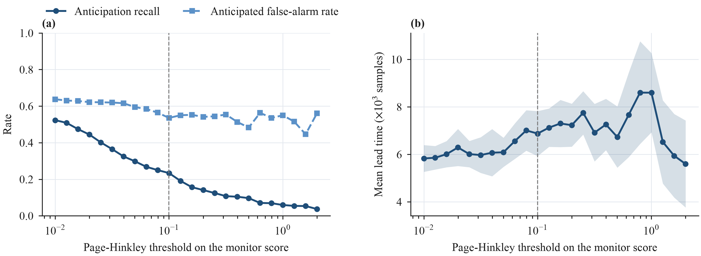

# Experiments 5 & 6 — Resource profile and operating-point sensitivity

Two reviewer-facing analyses that need **no re-run** — both are built from the
existing run outputs (`scripts/reviewer_analysis.py`).

---

## Experiment 5 — Real-time resource profile

### Question

Is this deployable on a streaming IDS? What is the throughput, the latency tail,
and where does the compute go?

### Results

Mean over the ten core seeds; ADWIN, KSWIN and continuous ARF/SRP were only run
on five.

- **Throughput** (samples/s): the HAT phases run at ~2.4K–13.3K/s; continuous
  ensembles are far heavier — ARF ~1.0K/s, and **SRP ~130/s** (its p95 latency
  is ~11 ms/sample vs sub-ms for HAT). C_early ~7.5K/s, B ~7.8K/s.
- **Latency tail**: per-sample latency is **sub-millisecond typically** (p50
  0.04–0.07 ms in every HAT arm, PACE included, except KSWIN at 0.35 ms because its
  KS test runs on every sample; p99 0.7–1.3 ms), but the monitor's periodic refit
  **spikes the max to ~1 s** — the relevant number for a line-rate IDS, and worth
  stating openly.
- **Wall-clock is load-dependent.** Apart from KSWIN, throughput gaps between the
  HAT arms are not a method ranking: B alone spans ~4.2K–20.4K/s across seeds, and
  its seeds 5–9 ran in a busier batch (inference ~130 s vs ~76 s for the same
  work). At five seeds B read 10.8K/s and PACE looked ~a third costlier; at ten
  the gap is gone. What PACE does add is its monitor, ~28 s per run (~10% of its
  compute).
- **Where the time goes**: the proactive arm spends a visible slice in the shift
  monitor; the HAT
  update/inference is the rest.

### Interpretation

The proposed C_early is cheap and real-time-friendly (sub-ms typical, ~2× the
baseline memory for the autoencoder). The **SOTA ensembles are expensive** —
another reason budget-matched and early-triggered ensemble variants (learn only in
windows) matter: they are both more accurate and cheaper than continuous SRP.

---

## Experiment 6 — C_early operating-point sensitivity

### Question

C_early's recon Page-Hinkley threshold was calibrated (0.1). Is that an overfit
knife-edge, or is the behaviour stable across a band? And what recall does the
anticipation actually achieve?

### Setup

The recon-error series is persisted per run, so the Page-Hinkley threshold can be
swept **offline** (no autoencoder re-run). For each threshold, recon fires are
paired against the recorded class fires to get anticipation recall, false-positive
rate, and lead time.

### Results

- At the operating threshold (0.1) the **anticipation recall is ~0.23** — the
  monitor foresees about a quarter of drifts (mean over ten seeds; max ~0.52 at the most aggressive
  setting). This is the honest limitation of the early monitor.
- **Lead time is stable at ~6–8K samples across a wide threshold band**, so 0.1 is
  not an overfit knife-edge.

### Interpretation

The anticipation signal is **robust but low-recall**: when it fires it genuinely
leads the drift by thousands of samples, but it catches only a fraction of drifts.
Improving recall (a better monitor, or fusing multiple shift statistics) is the
clearest lever to widen C_early's — and the early-triggered ensembles' — advantage.

### Caveats

- The offline sweep z-scores / thresholds the persisted series; the recon fires it
  produces approximate but do not exactly reproduce the online Page-Hinkley used
  in the live runs (the coupling between recon fires and adaptation is not
  replayed). It is a sensitivity analysis, not a re-simulation.
