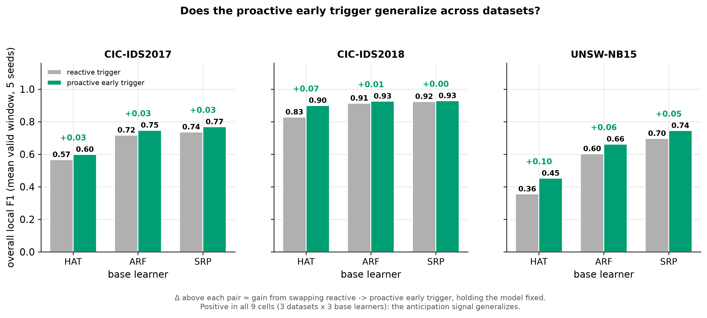

# Experiment 4 — External validity across datasets (CIC-IDS2018 + UNSW-NB15)

## Question

[Experiment 3c](03c-early-ensemble.md) showed the proactive early-detection
trigger improves *every* base learner on CICIDS2017, using fewer adaptations
than the reactive baseline. That result is tied to one dataset's specific
attack ordering.

> Does the proactive early trigger's 3c result — helps every base learner,
> fewer adaptations — hold on datasets beyond CICIDS2017?

## Setup

**Track and datasets.** Natural-drift networks, CICFlowMeter feature family.
Anchor: CICIDS2017 (existing 5-seed run). Added: **CIC-IDS2018** and
**UNSW-NB15** (a CICFlowMeter *re-extraction* of UNSW-NB15 — same ~80-feature
pipeline as 2017/2018, not the classic 49-feature Argus/Bro set — contributing a
genuinely different attack taxonomy: Exploits, Fuzzers, Reconnaissance,
Generic, DoS, Shellcode, Backdoor, Analysis, Worms).

**Dataset selection was evidence-driven.** A one-pass label-ordering
diagnostic (transitions/rows, run-length encoding) was run over all candidate
CSVs before committing compute. Two IoT candidates were rejected for this
purpose: **CICIoT2023** is fully shuffled (transitions/rows ≈ 0.91 — no
temporal drift to detect), and **Edge-IIoTset** is class-sorted with hard
block boundaries (transitions/rows ≈ 0 — covariate shift and label change
coincide at the same row, so anticipation lead time would be ≈ 0, exactly the
condition under which the anticipation claim cannot be demonstrated). The
CICFlowMeter family (2018, UNSW) showed gradual/bursty natural drift matching
the existing methodology, so those two were run instead.

**Minimal 2×2, per dataset.** The same six phases as experiment 3c — **B,
C_early** (HAT) and **ARF_sched/ARF_early, SRP_sched/SRP_early** — × 10 seeds
(originally 5; extended on 2026-07-28, see [experiment 6](06-timing-vs-frequency.md)).
The null GAN-augmentation phases (C, C_cond, C') and the monitor ablations are
**not** rerun; those results are already established on 2017 and are
off-message for a generalization check.

**Per-dataset evaluation window** (chosen by a drift-density scan,
`scripts/scan_drift_window.py`):
- **CIC-IDS2018**: rows 11M–14M (3M-sample window), the densest attack block
  after an intervening multi-million-row benign desert — DoS-Hulk,
  Infiltration, DDOS-HOIC, DDOS-LOIC-UDP, Bot, FTP-BruteForce, SSH-BruteForce
  arriving in separated bursts.
- **UNSW-NB15**: rows 1.75M–3.45M (1.7M-sample window), the dense second half
  of the file where all 9 attack families burst on a benign background.

**Per-dataset schedule.** Pass-0 Phase B fires **124 events on CIC-IDS2018**
and **117 events on UNSW-NB15** (same shared-schedule design 2017 uses with
its 233-event schedule — scheduled phases on a dataset replay that dataset's
own pass-0 indices).

**Monitor calibration.** C_early's recon Page-Hinkley threshold (`0.1`,
`delta=0.0005` on 2017) was checked on a short smoke run *before* committing
to the full 5-seed runs, per the offline-calibration rule in
[methodology.md §6](../methodology.md). **The 2017 value generalized on both
datasets without retuning**: a 1M-sample smoke on 2018 fired 185 adaptations
(72 recon / 113 class, mean anticipation lead ~3.2K samples); a 200K-sample
smoke on UNSW fired 25 adaptations (14 recon / 11 class, mean lead ~6.3K
samples). Both fire on the real bursts, not on every window, so the ported
threshold was pinned as-is (`configs/datasets/cicids2018.yaml`,
`configs/datasets/unsw.yaml`).

## Results

Overall local F1 (mean over valid rolling windows, 10 seeds) and mean
adaptation count, reactive (`B`/`*_sched`) vs proactive (`C_early`/`*_early`):

| Dataset | Base learner | reactive F1 | proactive F1 | Δ | adaptations (reactive → proactive) |
|---|---|---|---|---|---|
| CIC-IDS2017 | HAT | 0.573 | 0.595 | +0.022 | 233 → 161 |
| CIC-IDS2017 | ARF | 0.718 | 0.748 | +0.030 | 233 → 113 |
| CIC-IDS2017 | SRP | 0.733 | 0.769 | +0.037 | 233 → 91 |
| CIC-IDS2018 | HAT | 0.830 | 0.901 | +0.071 | 124 → 305 |
| CIC-IDS2018 | ARF | 0.913 | 0.926 | +0.013 | 124 → 255 |
| CIC-IDS2018 | SRP | 0.925 | 0.929 | +0.004 | 124 → 256 |
| UNSW-NB15 | HAT | 0.463 | 0.474 | +0.011 | 117 → 214 |
| UNSW-NB15 | ARF | 0.597 | 0.658 | +0.061 | 117 → 173 |
| UNSW-NB15 | SRP | 0.695 | 0.746 | +0.050 | 117 → 167 |

*Every one of the 9 cells is a positive Δ; the CICIDS2017 rows reproduce
[Experiment 3c](03c-early-ensemble.md).*

## Interpretation

**What generalizes (the core claim).** The proactive early trigger improves
overall local F1 in **all 9 cells** — 3 datasets × 3 base learners — every Δ
is positive. The when-to-adapt signal helps every base learner tested on
every dataset tested. This is the headline external-validity result: the
constructive finding from 3c is not an artifact of CICIDS2017's specific
attack ordering.

**What does not generalize — reported plainly.**
- **Label efficiency is 2017-specific.** On 2017 the proactive trigger fires
  *fewer* adaptations than the reactive schedule (233 → 113 for ARF, 233 → 91
  for SRP). On 2018 and UNSW the dynamic trigger fires *more* than the
  budget-matched schedule (124 → 255/256 on 2018, 117 → 167/173 on UNSW). So
  "the same gain at a fraction of the adaptation budget" is a 2017 finding,
  not a universal property of the method — on the other two datasets the
  proactive trigger buys its F1 gain with *more* label-consuming adaptations,
  not fewer.
- **The "gains grow with model strength" pattern is 2017-specific.** On 2017,
  Δ grows with base-learner strength (HAT +0.022 → ARF +0.030 → SRP +0.037).
  On 2018 the pattern *reverses* — gains *shrink* with strength (HAT +0.071 →
  ARF +0.013 → SRP +0.004) — a ceiling effect: the ensembles already reach
  F1 0.91–0.93 on 2018, leaving little headroom for any trigger to add. On
  UNSW the ensembles gain the *most* (ARF +0.061, SRP +0.050, HAT +0.011).
  There is no universal monotone pattern by model strength; only the **sign**
  of the effect is invariant across datasets.

Combined: the *direction* of the 3c result is robust and general-purpose —
proactive beats reactive for every base learner on every dataset tried — but
the two second-order properties that made the 2017 result look especially
elegant (fewer adaptations, gains scaling with capacity) are dataset-specific
and should not be oversold as universal.

## Caveats

- **UNSW-NB15 is ~97% benign.** Its attack-type mix is also fairly stationary
  across the evaluated window, so the drift there is mainly benign↔attack
  bursts rather than attack-subtype turnover — a sparser, less varied drift
  signal than 2017/2018. Many rolling windows have no positive label and are
  excluded from F1 (not scored as failure), per the recovery-metric semantics
  in [methodology.md](../methodology.md).
- **UNSW-NB15 here is a re-extraction**, not the dataset's original 49-feature
  Argus/Bro release — it runs on the same CICFlowMeter pipeline as 2017/2018,
  which is why it was chosen, but its absolute numbers are not directly
  comparable to prior literature using the classic UNSW-NB15 feature set.
- **Monitor thresholds were recalibrated per dataset** (a short offline smoke
  run before each full 5-seed run, see Setup); the fact that the 2017 value
  generalized without retuning is itself a result, not an assumption made in
  advance.
- **Scope is deliberately narrow.** Only the minimal 6-phase 2×2 was rerun on
  the new datasets — the null GAN-augmentation phases and monitor ablations
  were not repeated, so this experiment speaks only to the when-to-adapt
  trigger's generalization, not to the (already-null) GAN-augmentation
  result.
- **Adaptation counts are not comparable across datasets in absolute terms**
  (schedule lengths differ: 233 on 2017 vs 124 on 2018 vs 117 on UNSW,
  reflecting each dataset's own pass-0 drift dynamics) — only the
  reactive → proactive direction *within* a dataset is meaningful.
- **Dataset selection was evidence-driven but not exhaustive** — the
  label-ordering diagnostic screened the candidates on hand; other
  CICFlowMeter-family datasets (e.g. CIC-DDoS2019) were not run.
