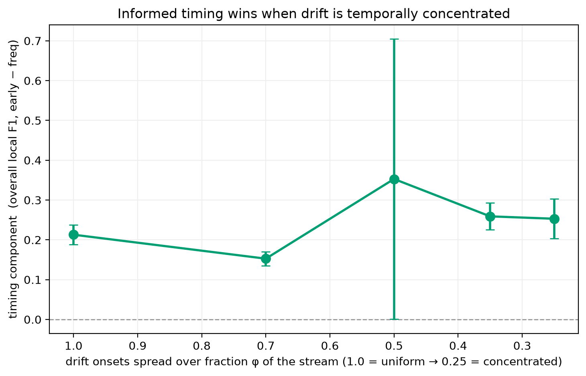

# Experiment 6 — Timing vs frequency (statistical hardening + decisive control)

## Question

[Experiment 4](05-external-validity.md) found the proactive early trigger positive
in all 9 dataset × base-learner cells, but with a caveat: on the external datasets
the proactive arm *fires more often* than the reactive schedule (1.4–2.5×), where
on CICIDS2017 it fires *fewer* times. Two objections follow, and this experiment
answers both from the already-persisted artifacts plus one small set of new runs:

> **(A)** Does the reported reactive→proactive gain survive proper inferential
> scrutiny, or is it seed noise?
> **(B)** On the external datasets, is the gain because the model adapts *earlier*
> (informed timing) or merely *more often* (frequency)?

## Part A — Statistical hardening (no new runs)

Overall local F1 paired by seed (**n=10**) between the reactive arm
(`B` / `*_sched`) and the proactive arm (`C_early` / `*_early`), with paired-t and
bootstrap CIs, sign pattern, event stratification, and prequential Kappa from the
traces. Script: `scripts/tier0_analysis.py`.

> Originally run at n=5; extended to 10 seeds per cell on 2026-07-28. The effect
> got **stronger**, not weaker — the opposite of what happened to the stability
> comparison in [experiment 7](07-unsupervised-comparator.md), which is why both
> were worth re-running.

- **Robust for the strong models.** **7/9 cells have a paired-t CI excluding 0**
  (5 ROBUST — every seed agrees in sign as well — plus 2 CI-signif where a single
  seed dissents). The 2 remaining WEAK cells are **HAT** ones (high seed
  variance); every ensemble cell has a CI excluding 0, five of the six with
  10/10 seeds agreeing at Wilcoxon p=0.002. Aggregate over the 9 cells: mean Δ
  **+0.043**, 95% CI **[+0.021, +0.065]**, 9/9 positive (sign test p=0.0039).
  *(At n=5 this read 6/9 ROBUST and +0.033 [+0.015, +0.051].)*
- **Confirmed in imbalance-aware metrics.** Prequential Kappa-M and
  Kappa-Temporal (from per-sample traces) are positive in all 9 cells. On the
  degenerate reactive HAT/2017, Kappa-Temporal is −1.93 (worse than a persistence
  classifier); the proactive arm improves it to −1.23 and lifts Kappa-M
  0.58→0.68.
- **Mechanism check (event stratification).** Splitting real (class-fire) drifts
  into anticipated vs reactive-only: anticipated drifts recover with lower AUD on
  2017 (HAT p=0.037, ARF p=0.013, SRP p<0.001) and on UNSW (ARF p<0.001, SRP
  p=0.016), but **not on 2018** (p≈0.94–0.99) — the first hint that the 2018 gain
  is not anticipation. Monitor false-alarm rate is high (30–80%).

## Part B — The decisive frequency-matched control (new runs)

For the cells where the proactive arm fires more (ARF/SRP on CIC-IDS2018 and
UNSW-NB15) we add `*_freq`: the same ensemble adapting only in triggered windows
on a **blind periodic clock**, with the interval calibrated so its fire count
matches `*_early` (generalises [experiment 1](01-frequency-control.md)'s C_freq
to the ensembles). Three arms then sit at comparable frequency, and the reported
gain decomposes, paired by seed, as:

```
early − sched (reported) = (freq − sched) frequency  +  (early − freq) timing
```

The clean, airtight statement is the **timing** component `early − freq` (same
fire count, informed vs blind placement). Script: `scripts/tier1_analysis.py`.

10 seeds per cell:

| dataset | learner | fires sched/freq/early | F1 sched/freq/early | Δ timing (early−freq) | verdict |
|---|---|---|---|---|:---:|
| CIC-IDS2018 | ARF | 124 / 254 / 253 | 0.913 / 0.888 / 0.926 | **+0.038** [+0.037, +0.038] | **timing** |
| CIC-IDS2018 | SRP | 124 / 256 / 254 | 0.924 / 0.881 / 0.929 | **+0.047** [+0.047, +0.048] | **timing** |
| UNSW-NB15 | ARF | 117 / 172 / 171 | 0.603 / 0.652 / 0.662 | +0.010 [+0.001, +0.019] | ~freq |
| UNSW-NB15 | SRP | 117 / 167 / 167 | 0.697 / 0.746 / 0.745 | −0.001 [−0.008, +0.006] | ~freq |

On UNSW the timing component stays an order of magnitude below CIC-IDS2018's: on
ARF it is a small residual (+0.010, ~17% of that cell's +0.059 total) whose CI
only just clears 0, and on SRP it is indistinguishable from 0. The
frequency-dominated reading of UNSW therefore stands.

> **Calibration caveat, recorded because it nearly went wrong.** The blind clock
> must fire as often as `*_early` *on that dataset*: 9549/9857 on UNSW versus
> 11587/11505 on 2017-2018. When seeds 5-9 were first run these values lived only
> in a CLI flag from an earlier session, so they silently fell back to the
> 2017-2018 interval and fired 142 times instead of 172. That inflated the UNSW
> timing component to +0.015 [+0.004, +0.026] on ARF and made SRP look
> significant (+0.007 [+0.001, +0.014]) — i.e. it would have reversed this
> section's conclusion. Those seeds were discarded and re-run; the intervals are
> now pinned in `configs/datasets/*.yaml` under `by_phase:` and covered by a test.


## Interpretation

- **The split is a property of the dataset, not the learner.** ARF and SRP agree
  cell-for-cell with tight CIs.
- **CIC-IDS2018 — genuinely timing.** Informed placement beats a blind clock at
  the same frequency by +0.038 (ARF) / +0.048 (SRP), and adapting *more* on a
  blind clock actively **hurts** (SRP's blind control 0.881 < the sparse reactive
  0.925). Here "adapt more" is counter-productive; *when* is what matters. The
  reported `early − sched` (+0.004 for SRP) badly understates this, because the
  timing gain is fighting a −0.044 frequency penalty.
- **UNSW-NB15 — frequency, honestly.** The timing component is ~0 (CIs straddle
  0); the gain is adapting more often. UNSW's drift is described in its profile as
  benign↔attack bursts rather than attack-type turnover — placement matters less.
- **Sharper claim.** Informed timing helps in proportion to how *structured* the
  drift is: discrete blocks (2017, 2018) → timing; dense bursts (UNSW) →
  frequency.

## Honesty note / what this does *not* prove

The block-vs-burst pattern is an **empirical observation across three real
datasets (n=3)**, not a demonstrated mechanism. Two **pre-specified** synthetic
experiments tried to isolate a drift-structure mechanism and **both failed** to:

- `scripts/synthetic_structure.py` (sweep drift *block size*): no monotone
  relationship — large blocks let a blind clock re-adapt mid-block, and uniformly
  spaced drifts align with a count-matched uniform clock.
- `scripts/synthetic_clustering.py` (sweep *temporal concentration* φ of onsets):
  the timing benefit was large and positive at *every* φ (~+0.2), not increasing
  with concentration.



Per the pre-registered decision rule the drift-structure claim is **retreated**.
What the second synthetic *does* show is the **core** result in a controlled
setting: informed timing beats a blind clock at matched adaptation frequency
(+0.21 even with uniformly spaced drifts). So: report the real-dataset split as an
empirical observation, claim the "when to adapt" benefit, and do **not** claim a
structure mechanism in the abstract. See
`results/report/synthetic_clustering/analysis.md`.

## Reproducing

```bash
# Part A — statistical hardening over existing runs (no new compute)
uv run python scripts/tier0_analysis.py

# Part B — frequency-matched controls (calibrated interval per cell)
uv run python run_experiment.py --phase ARF_freq --dataset cicids2018 --seeds 0,1,2,3,4 --n-jobs 5 --periodic-adapt-interval 11587
uv run python run_experiment.py --phase SRP_freq --dataset cicids2018 --seeds 0,1,2,3,4 --n-jobs 5 --periodic-adapt-interval 11505
uv run python run_experiment.py --phase ARF_freq --dataset unsw       --seeds 0,1,2,3,4 --n-jobs 5 --periodic-adapt-interval 9549
uv run python run_experiment.py --phase SRP_freq --dataset unsw       --seeds 0,1,2,3,4 --n-jobs 5 --periodic-adapt-interval 9857
uv run python scripts/tier1_analysis.py
```
